# Laboratorio 9 Escalamiento en Azure con Máquinas Virtuales

### Escuela Colombiana de Ingeniería Julio Garavito
### Arquitecturas de Software - ARSW

**Integrantes**
- Mariana Malagón
- Paula Lozano

**Repositorio:** https://github.com/marianamalagon11/ARSW_LOAD-BALANCING_AZURE

> El enunciado del laboratorio está en [README.md](README.md).

---

## Tabla de contenido

- [Parte 1: Escalabilidad vertical](#parte-1-escalabilidad-vertical)
  - [Checklist](#checklist-parte-1)
  - [Cambios frente a la guía](#cambios-frente-a-la-guía-parte-1)
  - [Evidencias](#evidencias-parte-1)
  - [Preguntas](#preguntas-parte-1)
- [Parte 2: Escalabilidad horizontal](#parte-2-escalabilidad-horizontal)
  - [Desviaciones respecto a la guía](#desviaciones-respecto-a-la-guía)
  - [Evidencias](#evidencias-parte-2)
  - [Preguntas](#preguntas-parte-2)
- [Diagrama de despliegue](#diagrama-de-despliegue)
- [Conclusiones](#conclusiones)
- [Limpieza de recursos](#limpieza-de-recursos)

---

# Parte 1: Escalabilidad vertical

## Checklist: Parte 1

**Creación de la VM**
- [x] Crear la VM: Resource Group `SCALABILITY_LAB`, nombre `VERTICAL-SCALABILITY`, usuario `scalability_lab`, autenticación con llave SSH (el tamaño y la imagen cambiaron, ver [cambios frente a la guía](#cambios-frente-a-la-guía-parte-1))
- [x] Conectarnos por SSH: `ssh scalability_lab@<IP_PUBLICA>`
- [x] Instalar Node.js con NVM
- [x] Clonar el repositorio y correr `npm install` dentro de `FibonacciApp`
- [x] Correr la aplicación: `node FibonacciApp.js`
- [x] Crear la Inbound port rule para el puerto `3000` en *Networking*
- [x] Verificar que `http://<IP_PUBLICA>:3000/fibonacci/6` responda `The answer is 8`

**Mediciones con el tamaño pequeño (D1_v2)**
- [x] Medir los tiempos desde la consola del navegador para: 1000000, 1010000, 1020000, 1030000, 1040000, 1050000, 1060000, 1070000, 1080000, 1090000
- [x] Sacar la gráfica de CPU de la VM en Azure
- [x] Instalar newman en una máquina distinta a la VM: `npm install newman -g`
- [x] En `FibonacciApp/postman/part1/[ARSW_LOAD-BALANCING_AZURE].postman_environment.json` cambiar `VM1` por la IP de la VM
- [x] Correr la prueba de carga con 2 procesos en paralelo y guardar el resumen

**Escalamiento vertical**
- [x] Cambiar el tamaño de la VM a `D2_v2` (sección *Size*)
- [x] Repetir los tiempos, la gráfica de CPU y la prueba de newman
- [x] Evaluar si se cumple el escenario de calidad
- [x] Correr newman con 4 procesos en paralelo (pregunta 11)
- [ ] Devolver la VM al tamaño inicial `D1_v2` para no gastar créditos (lo mostramos en el video)

Este es el comando de carga que usamos, desde `FibonacciApp/postman/part1`:

```bash
newman run ARSW_LOAD-BALANCING_AZURE.postman_collection.json -e "[ARSW_LOAD-BALANCING_AZURE].postman_environment.json" -n 10 &
newman run ARSW_LOAD-BALANCING_AZURE.postman_collection.json -e "[ARSW_LOAD-BALANCING_AZURE].postman_environment.json" -n 10
```

> Ojo: en PowerShell el `&` no manda los procesos a segundo plano. Lo mejor es usar Git Bash o WSL, o abrir una ventana por cada ejecución:
>
> ```powershell
> Start-Process newman -ArgumentList 'run','ARSW_LOAD-BALANCING_AZURE.postman_collection.json','-e','[ARSW_LOAD-BALANCING_AZURE].postman_environment.json','-n','10'
> ```

## Cambios frente a la guía: Parte 1

La Parte 1 la hicimos en la suscripción de *Azure for Students* de Paula, que es distinta a la de la Parte 2 y tiene sus propias restricciones. Por eso nos tocó cambiar algunas cosas:

| Qué | La guía pide | Lo que usamos | Por qué |
|---|---|---|---|
| Tamaño pequeño | `Standard_B1ls` | `Standard_D1_v2` (1 vCPU, 3.5 GiB) | La suscripción tiene bloqueada toda la serie B (`B1ls`, `B1s`, `B1ms`, `B2s`, `B2ms`) en las 5 regiones que deja usar (`chilecentral`, `eastus`, `eastus2`, `canadacentral`, `southcentralus`). Aparecen como `NotAvailableForSubscription`. Lo revisamos con `az vm list-skus` y con la API de SKUs de Azure. |
| Tamaño grande | `Standard_B2ms` | `Standard_D2_v2` (2 vCPU, 7 GiB) | Por lo mismo. Escogimos D1_v2 y D2_v2 porque repiten justo el salto de 1 a 2 vCPU de la guía y los dos están disponibles en la misma región, así que el cambio de tamaño sí funciona. |
| Región | No dice | Chile Central | Era la única región permitida que tenía esos dos tamaños en x64. |
| Imagen | Ubuntu Server 18.04 | Ubuntu Server 24.04 LTS, Gen1 | D1_v2 solo acepta imágenes de generación 1 y el portal no nos ofrecía Ubuntu 22.04 en Gen1. La 18.04 ya ni existe en el Marketplace. |

Algo bueno de este cambio: los tamaños Dv2 no son burstable, o sea que dan el 100 % de su CPU todo el tiempo, sin depender de créditos. Eso nos quita una variable de encima y hace que la comparación entre los dos tamaños sea más limpia. El experimento sigue siendo el mismo de la guía: una VM de 1 vCPU que escalamos a 2 vCPU.

## Evidencias: Parte 1

### Creación de la VM

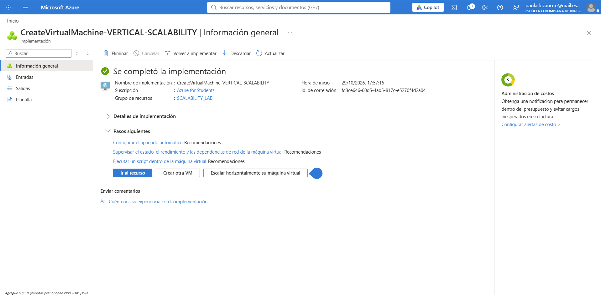

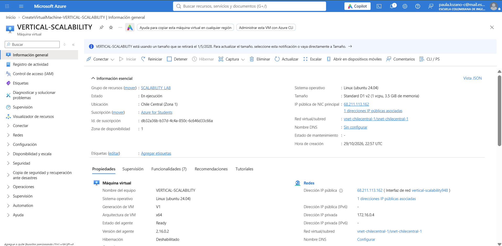

| Dato | Valor |
|---|---|
| Resource Group | `SCALABILITY_LAB` |
| Nombre | `VERTICAL-SCALABILITY` |
| Región | Chile Central (zona 1) |
| Imagen | Ubuntu Server 24.04 LTS, generación 1 |
| Tamaño inicial | `Standard_D1_v2` (1 vCPU, 3.5 GiB) |
| Usuario | `scalability_lab`, con llave SSH |
| IP pública | `68.211.113.162` |
| IP privada | `172.16.0.4` |

Estos son los recursos que Azure nos creó junto con la VM:

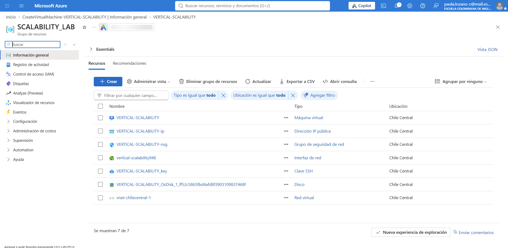

### Aplicación corriendo

La regla `Port_3000` (prioridad 310) es la que abre el puerto de la aplicación. Más abajo están las reglas que Azure pone por defecto, entre ellas `DenyAllInBound` (65500), que es la que bloquea el 3000 si no creamos la regla.

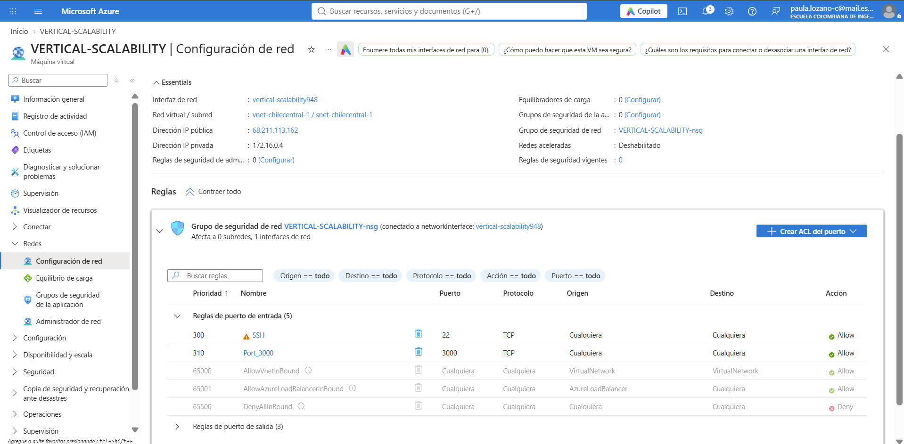

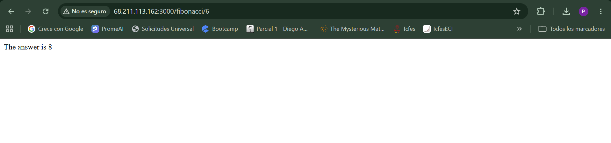

Dejamos la aplicación corriendo con `forever start FibonacciApp.js` para que no se cayera al cerrar la sesión SSH.

### Tiempos de respuesta con D1_v2

Los tiempos los tomamos desde la consola del navegador (F12, pestaña *Console*), abierta en `http://68.211.113.162:3000/`, con este script que manda las peticiones una por una y mide cuánto tarda cada una:

```js
const ns = [1000000,1010000,1020000,1030000,1040000,1050000,1060000,1070000,1080000,1090000];
const rows = [];
for (const n of ns) {
  const t0 = performance.now();
  const r = await fetch(`/fibonacci/${n}`);
  await r.text();
  rows.push({ n, status: r.status, segundos: ((performance.now() - t0) / 1000).toFixed(2) });
}
console.table(rows);
```

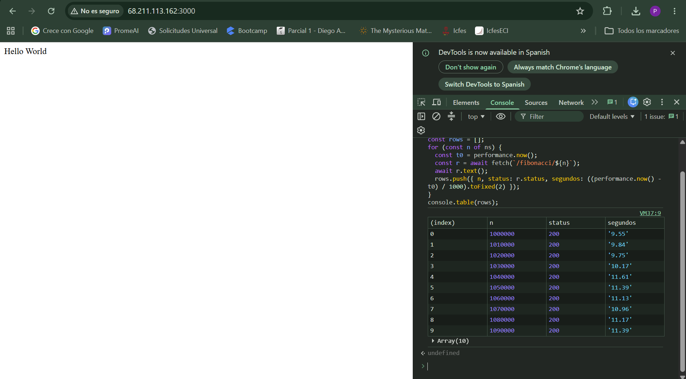

| n | Tiempo con D1_v2 (s) |
|---|---|
| 1000000 | 9.55 |
| 1010000 | 9.84 |
| 1020000 | 9.75 |
| 1030000 | 10.17 |
| 1040000 | 11.61 |
| 1050000 | 11.39 |
| 1060000 | 11.13 |
| 1070000 | 10.96 |
| 1080000 | 11.17 |
| 1090000 | 11.39 |
| Promedio | 10.70 |

Las 10 nos respondieron `200`. Ninguna falló, porque las mandamos de a una.

### Consumo de CPU con D1_v2

Aquí miramos la métrica *Percentage CPU*, con agregación máximo.

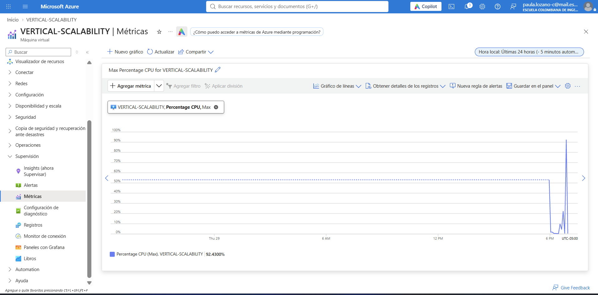

Llegó a 92.43 % mientras medíamos los tiempos. La línea punteada en 50 % que se ve a la izquierda no es un dato real: es el portal rellenando el rato antes de que existiera la VM.

### Prueba de newman con D1_v2

Corrimos dos procesos de newman al mismo tiempo, 10 iteraciones cada uno, con `n = 1000000`.

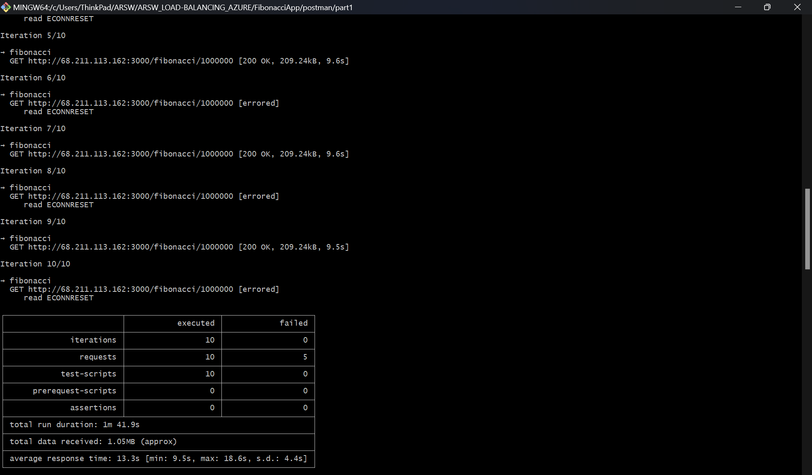

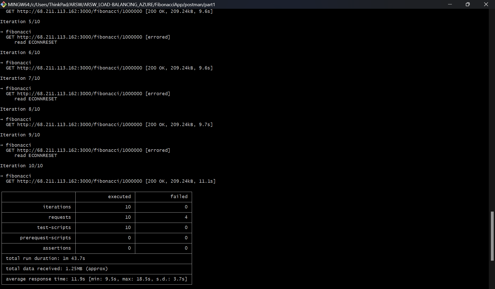

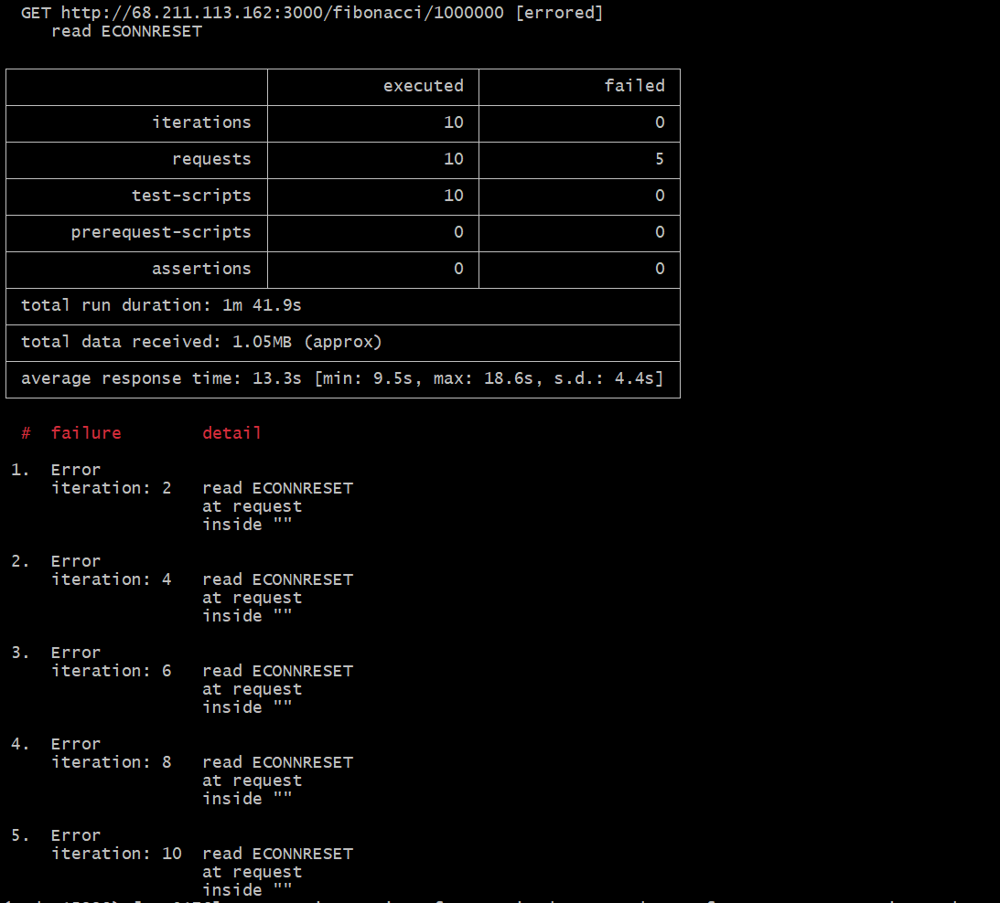

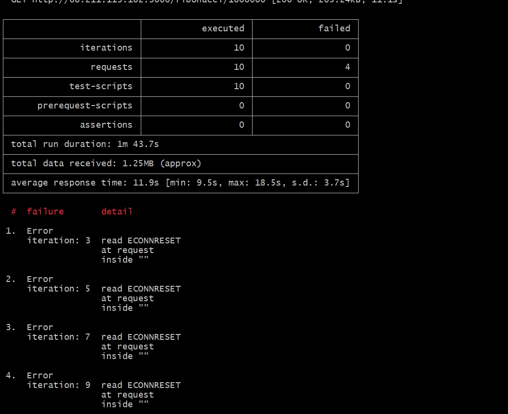

| Dato | Proceso A | Proceso B |
|---|---|---|
| Peticiones | 10 | 10 |
| Fallidas | 5 (iteraciones 2, 4, 6, 8, 10) | 4 (iteraciones 3, 5, 7, 9) |
| Error | `read ECONNRESET` | `read ECONNRESET` |
| Duración total | 1m 41.9s | 1m 43.7s |
| Tiempo promedio | 13.3 s | 11.9 s |
| Mínimo / Máximo | 9.5 s / 18.6 s | 9.5 s / 18.5 s |
| Desviación estándar | 4.4 s | 3.7 s |

En total respondió 11 de 20, o sea el 55 %. Lo que pasó con los fallos lo contamos en la [pregunta 6](#preguntas-parte-1).

### Cambio de tamaño a D2_v2

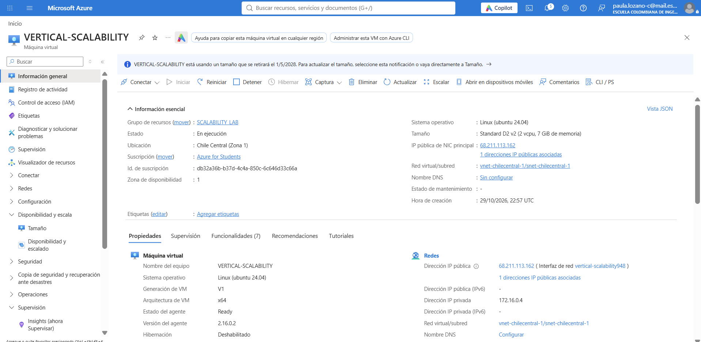

Es la misma VM, con la misma IP (`68.211.113.162`) y el mismo disco. Lo único que le cambiamos fue el tamaño: ahora tiene 2 vCPU y 7 GiB.

### Tiempos de respuesta con D2_v2


| n | D1_v2 (s) | D2_v2 (s) | Diferencia |
|---|---|---|---|
| 1000000 | 9.55 | 9.08 | 4.9 % menos |
| 1010000 | 9.84 | 9.21 | 6.4 % menos |
| 1020000 | 9.75 | 9.36 | 4.0 % menos |
| 1030000 | 10.17 | 9.55 | 6.1 % menos |
| 1040000 | 11.61 | 9.68 | 16.6 % menos |
| 1050000 | 11.39 | 10.03 | 11.9 % menos |
| 1060000 | 11.13 | 10.00 | 10.2 % menos |
| 1070000 | 10.96 | 10.48 | 4.4 % menos |
| 1080000 | 11.17 | 10.25 | 8.2 % menos |
| 1090000 | 11.39 | 10.73 | 5.8 % menos |
| Promedio | 10.70 | 9.84 | 8.0 % menos |

### Consumo de CPU con D2_v2

Usamos la misma métrica *Percentage CPU*, agregación máximo, en los últimos 30 minutos. En la gráfica se alcanzan a ver las dos fases:

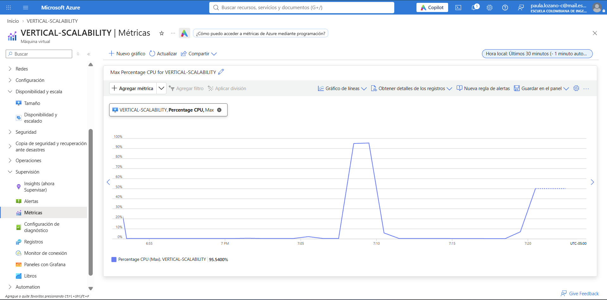

| Momento (hora local) | Tamaño | CPU máxima |
|---|---|---|
| 7:08 a 7:10 p. m. | D1_v2, prueba de newman | 95.54 % |
| desde las 7:20 p. m. | D2_v2, tiempos y prueba de newman | cerca de 50 % |

Con la misma carga, la CPU que reporta Azure baja a la mitad. En la [pregunta 10](#preguntas-parte-1) explicamos por qué eso no es tan bueno como parece.

### Prueba de newman con D2_v2

Los resultados completos están en `FibonacciApp/postman/part1/d2v2-1.txt` y `d2v2-2.txt`.

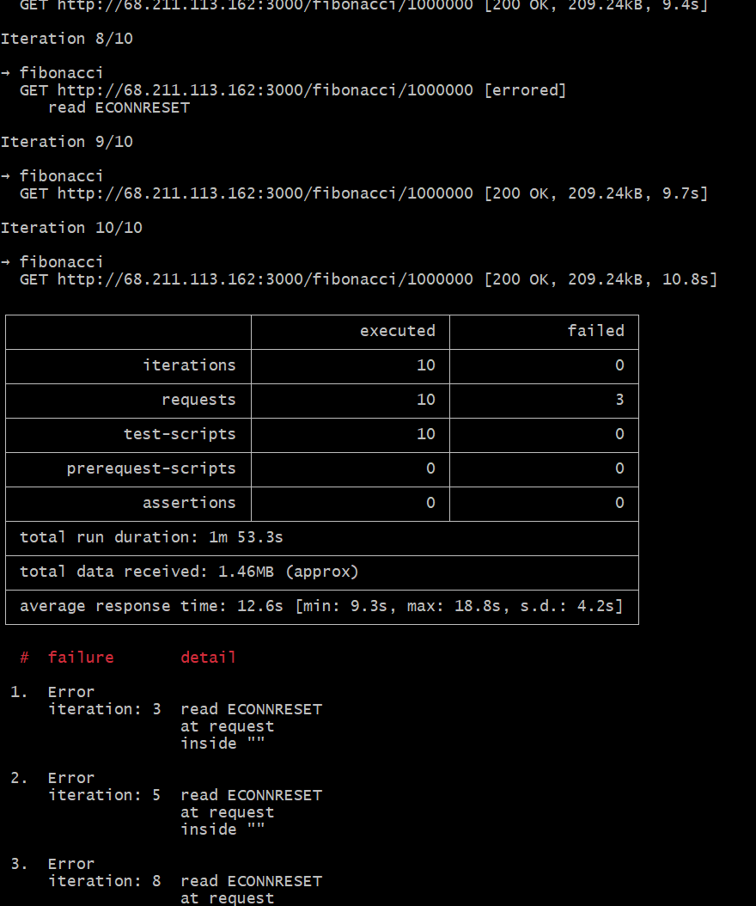

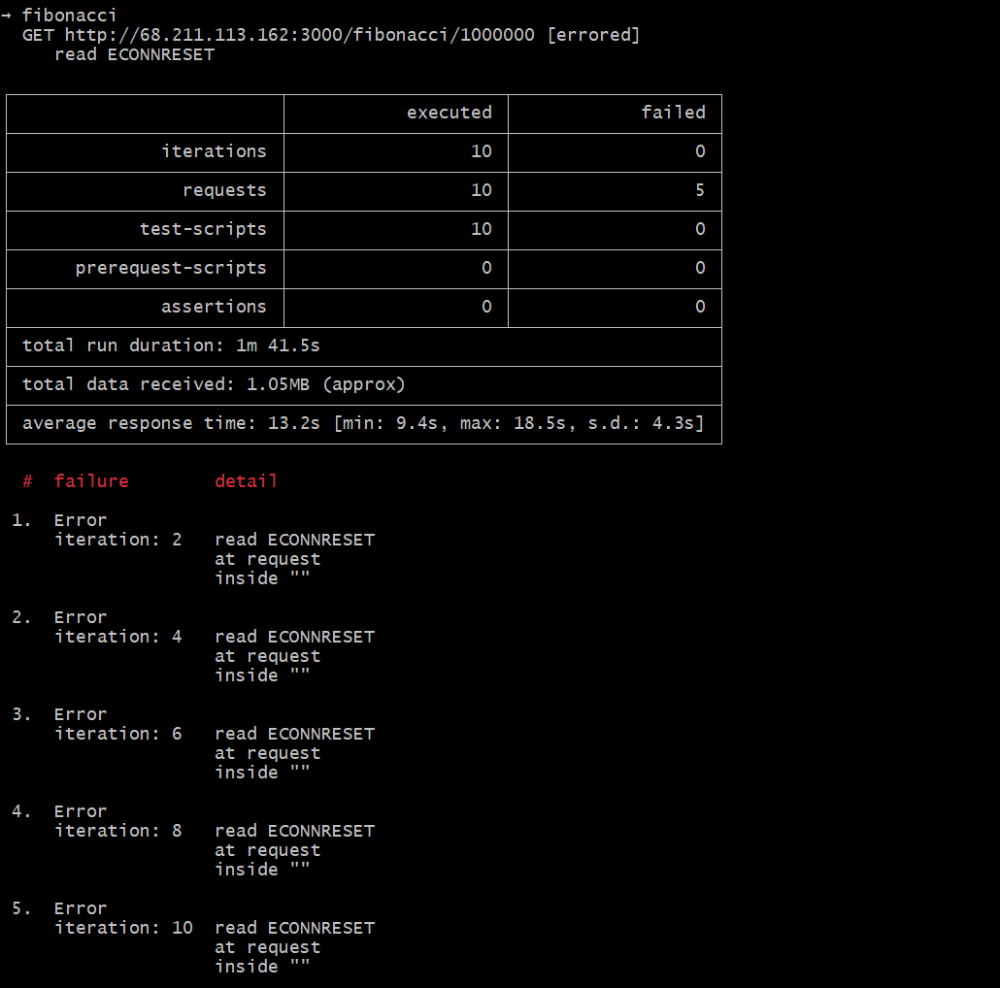

| Dato | Proceso A | Proceso B |
|---|---|---|
| Peticiones | 10 | 10 |
| Fallidas | 3 (iteraciones 3, 5, 8) | 5 (iteraciones 2, 4, 6, 8, 10) |
| Error | `read ECONNRESET` | `read ECONNRESET` |
| Duración total | 1m 53.3s | 1m 41.5s |
| Tiempo promedio | 12.6 s | 13.2 s |
| Mínimo / Máximo | 9.3 s / 18.8 s | 9.4 s / 18.5 s |
| Desviación estándar | 4.2 s | 4.3 s |

Esta vez respondió 12 de 20, el 60 %. Prácticamente lo mismo que con 1 vCPU.

### Prueba de newman con 4 procesos en paralelo

Aquí lanzamos cuatro procesos de newman al mismo tiempo contra la VM en D2_v2. Los resultados completos están en `FibonacciApp/postman/part1/d2v2-4x-1.txt` a `d2v2-4x-4.txt`.

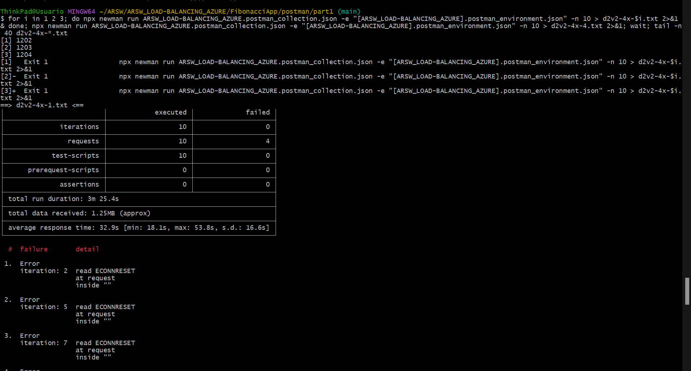

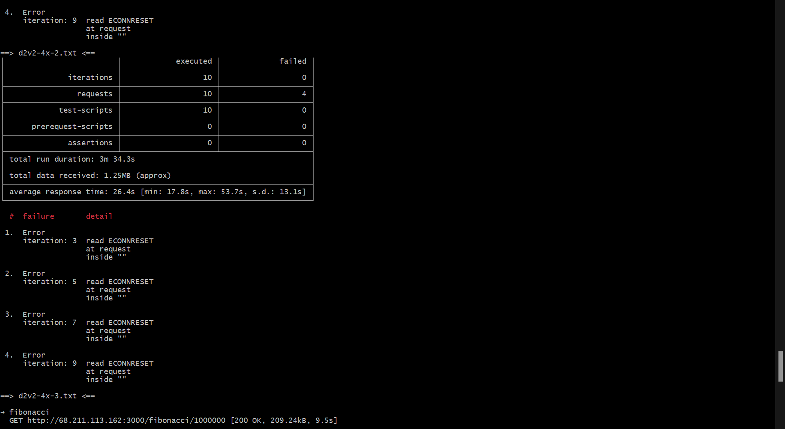

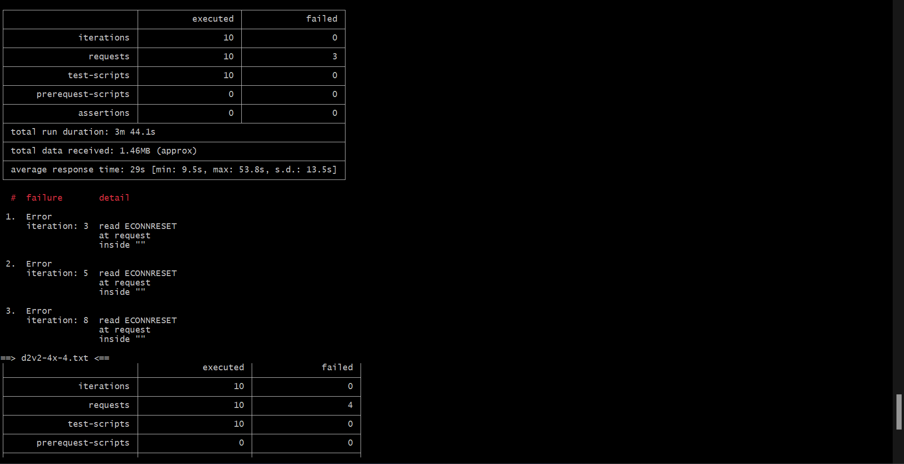

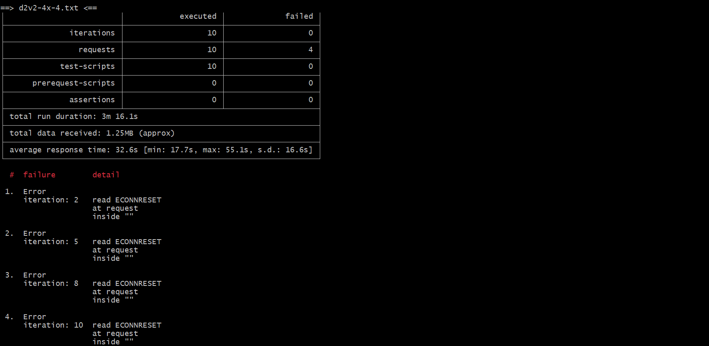

| Dato | Ejec. 1 | Ejec. 2 | Ejec. 3 | Ejec. 4 |
|---|---|---|---|---|
| Peticiones | 10 | 10 | 10 | 10 |
| Fallidas | 4 | 4 | 3 | 4 |
| Duración total | 3m 25.4s | 3m 34.3s | 3m 44.1s | 3m 16.1s |
| Tiempo promedio | 32.9 s | 26.4 s | 29.0 s | 32.6 s |
| Mínimo / Máximo | 18.1 s / 53.8 s | 17.8 s / 53.7 s | 9.5 s / 53.8 s | 17.7 s / 55.1 s |

Respondió 25 de 40, el 62.5 %. Todos los fallos fueron otra vez `read ECONNRESET`.

### VM devuelta a D1_v2

El regreso a `Standard_D1_v2` lo mostramos en vivo en el video, junto con lo que le pasa a la aplicación durante el cambio.

## Preguntas: Parte 1

**1. ¿Cuántos y cuáles recursos crea Azure junto con la VM?**

Aparte de la máquina virtual, Azure nos creó 6 recursos más, o sea 7 en total. Se ven en la captura [13-recursos-grupo](#creación-de-la-vm):

| Recurso | Nombre en nuestro despliegue |
|---|---|
| Máquina virtual | `VERTICAL-SCALABILITY` |
| Disco del sistema operativo | `VERTICAL-SCALABILITY_OsDisk_1_ff52c5865fbd4afd8f3903109837468f` |
| Interfaz de red (NIC) | `vertical-scalability948` |
| IP pública | `VERTICAL-SCALABILITY-ip` |
| Network Security Group | `VERTICAL-SCALABILITY-nsg` |
| Red virtual (con su subred `snet-chilecentral-1`) | `vnet-chilecentral-1` |
| Clave SSH | `VERTICAL-SCALABILITY_key` |

La clave SSH aparece como recurso porque la generamos desde el portal. Si subes una llave que ya tienes, ese recurso no se crea y quedan 6.

**2. ¿Brevemente describa para qué sirve cada recurso?**

- Máquina virtual: es el cómputo. Define el tamaño (vCPU y RAM), la imagen del sistema operativo y amarra todo lo demás.
- Disco del sistema operativo: es donde quedan guardados Ubuntu, Node.js y la aplicación. Es independiente de la VM, por eso aguanta reinicios y cambios de tamaño. De hecho, cuando pasamos de D1_v2 a D2_v2 no perdimos nada de lo que habíamos instalado.
- NIC: conecta la VM con la subred. Tiene la IP privada (`172.16.0.4`) y a ella se le pegan la IP pública y el NSG.
- IP pública: es la dirección para llegar desde internet (`68.211.113.162`). Sin ella no tendríamos cómo entrar por SSH ni cómo usar el endpoint desde afuera.
- NSG: es el firewall. Decide qué tráfico entra y sale de la NIC. Cuando se creó, solo dejaba pasar el 22 (SSH).
- Red virtual y subred: la red privada donde vive la VM y el rango de donde sale su IP privada.
- Clave SSH: guarda en Azure la llave pública para poder usarla en otras VMs. La privada (el `.pem`) solo la tenemos nosotras.

**3. ¿Al cerrar la conexión ssh con la VM, por qué se cae la aplicación que ejecutamos con el comando `npm FibonacciApp.js`? ¿Por qué debemos crear un *Inbound port rule* antes de acceder al servicio?**

Porque el proceso `node FibonacciApp.js` es hijo de la sesión de la terminal que abrimos por SSH. Cuando cerramos la conexión, Linux le manda la señal `SIGHUP` (*hang up*) a todos los procesos de esa sesión, y Node, como no la maneja, se cierra. El proceso nunca fue independiente: estaba amarrado a la terminal. En el video lo mostramos en vivo: cerramos la ventana de SSH, recargamos el navegador y la app ya no responde.

Para que no pase, hay que despegar el proceso de la sesión. Nosotras usamos `forever start FibonacciApp.js`, que corre el proceso aparte de la terminal y además lo vuelve a levantar si se cae. También sirven `pm2`, `nohup node FibonacciApp.js &` o un servicio de `systemd`, que fue lo que usamos en la Parte 2.

La Inbound port rule hace falta porque el NSG que viene con la VM trae la regla `DenyAllInBound` (prioridad 65500), que bloquea todo lo que no se haya permitido a propósito, y al crear la VM solo quedó abierto el 22. La aplicación escucha en el 3000, así que sin una regla para ese puerto las peticiones se botan antes de llegar a la máquina y el navegador se queda esperando hasta que se rinde.

Esto nos pasó de verdad: la primera vez la regla quedó creada en el puerto 8080, que es el que el portal pone por defecto. La app estaba corriendo, pero el navegador no cargaba nada. Apenas la cambiamos a 3000, funcionó.

**4. Adjunte tabla de tiempos e interprete por qué la función tarda tanto tiempo.**

La tabla está en [Tiempos de respuesta con D1_v2](#tiempos-de-respuesta-con-d1_v2) y la comparación en [Tiempos de respuesta con D2_v2](#tiempos-de-respuesta-con-d2_v2).

Con 1 vCPU cada cálculo nos tardó entre 9.55 s (n = 1000000) y 11.61 s, con un promedio de 10.70 s. Y nos llamó la atención algo: el tiempo crece más rápido que n. De 1000000 a 1090000, n sube un 9 %, pero el tiempo sube un 19 % (de 9.55 s a 11.39 s).

La función es lenta por tres cosas que se suman:

1. Hace n iteraciones: para n = 1000000 son un millón de sumas.
2. Cada suma es con enteros gigantes (`big-integer`). El Fibonacci de un millón tiene unos 209.000 dígitos, y eso cuadra con los 209.24 kB que newman dice que pesa cada respuesta. Como cada suma recorre números cada vez más largos, el costo real se parece más a n² que a n. Por eso el tiempo crece más de lo que crece n.
3. Crea un objeto nuevo en cada vuelta, lo que deja muchísima basura y pone a trabajar de más al recolector de memoria de V8.

Con un algoritmo de *fast doubling* el mismo cálculo se haría con unas pocas multiplicaciones (del orden de log n), en una fracción del tiempo.

**5. Adjunte imágen del consumo de CPU de la VM e interprete por qué la función consume esa cantidad de CPU.**

Lo pueden ver en [Consumo de CPU con D1_v2](#consumo-de-cpu-con-d1_v2): llegó a 92.43 % mientras medíamos los tiempos y a 95.54 % con la prueba de newman.

El cálculo usa solo CPU: no espera disco, ni red, ni base de datos, simplemente suma y suma. Node.js corre el JavaScript en un solo hilo (el *event loop*), así que mientras calcula, ese hilo tiene un núcleo al 100 %. Como `D1_v2` tiene un solo vCPU, con una sola petición basta para dejar la máquina casi al tope. Lo poquito que queda lo usan el sistema operativo y la red.

Y hay otra cosa importante: mientras el event loop está ocupado, la aplicación no puede atender ninguna otra petición. Las demás se quedan haciendo fila. Esto es clave para entender los fallos de la pregunta 6.

**6. Adjunte la imagen del resumen de la ejecución de Postman. Interprete los tiempos de ejecución de cada petición y, si hubo fallos, documéntelos y explíquelos.**

Las imágenes están en [Prueba de newman con D1_v2](#prueba-de-newman-con-d1_v2) y [Prueba de newman con D2_v2](#prueba-de-newman-con-d2_v2).

Sobre los tiempos: las peticiones que funcionaron tardaron casi siempre una de dos cosas, nunca algo en el medio.

| Tiempo | Qué pasó |
|---|---|
| unos 9.5 s | La petición llegó con el servidor libre y se calculó de una. |
| unos 18.5 s | Llegó mientras se calculaba la del otro proceso. Le tocó esperar esos 9.5 s en fila y después otros 9.5 s de su propio cálculo. |

Es justo el doble, y eso nos muestra que el servidor atiende las peticiones de a una: con dos clientes al tiempo, a uno siempre le toca esperar al otro. Por eso el promedio sube a 12 o 13 s aunque cada cálculo dure 9.5 s.

Sobre los fallos: fueron 9 de 20 con D1_v2 y 8 de 20 con D2_v2, todos con el mismo error, `read ECONNRESET`. Eso quiere decir que el servidor cerró la conexión mientras el cliente esperaba la respuesta. No fue un error HTTP ni que el cliente se cansara de esperar.

Lo que más nos llamó la atención fue el patrón: en cada proceso fallan iteraciones alternas (2, 4, 6, 8, 10 en uno; 3, 5, 7, 9 en el otro). Eso descarta que sean fallos al azar por carga y apunta a algo concreto. La explicación que mejor encaja con los datos es un choque entre el *keep-alive* de HTTP y el event loop bloqueado:

1. Newman usa la misma conexión TCP para todas sus iteraciones (*keep-alive*).
2. El servidor HTTP de Node cierra las conexiones *keep-alive* que llevan más de 5 segundos quietas (`server.keepAliveTimeout`, que por defecto es 5000 ms).
3. El proceso A recibe su respuesta y de una manda la siguiente petición por la misma conexión. Pero el servidor ya arrancó con la petición de B y el event loop se queda bloqueado unos 9.5 s: ni lee lo que mandó A, ni revisa sus temporizadores.
4. Cuando termina ese cálculo, el event loop revisa primero los temporizadores y después la red. El de la conexión de A (5 s) ya se venció hace rato, entonces el servidor la cierra, aunque tenía la petición de A sin leer. Al cerrarla con datos pendientes, el sistema operativo manda un RST y al cliente le llega `ECONNRESET`.
5. Newman abre una conexión nueva para la siguiente iteración, y esa sí funciona. Por eso los fallos van alternados.

En pocas palabras: la VM no se está cayendo por la carga. El servidor pierde peticiones porque un solo hilo bloqueado no da abasto con dos clientes. Y esto cuadra con lo que vimos en la Parte 2: allá cada proceso de newman cayó en su propia VM, nadie tuvo que esperar a nadie y no hubo ni un solo fallo.

**7. ¿Cuál es la diferencia entre los tamaños `B2ms` y `B1ls` (no solo busque especificaciones de infraestructura)?**

La guía compara `B1ls` con `B2ms`. Como esos no estaban disponibles en nuestra suscripción, ponemos también los que usamos:

| | `B1ls` | `B2ms` | `D1_v2` (usada) | `D2_v2` (usada) |
|---|---|---|---|---|
| vCPU | 1 | 2 | 1 | 2 |
| RAM | 0.5 GiB | 8 GiB | 3.5 GiB | 7 GiB |
| Tipo | Burstable | Burstable | Uso general, CPU constante | Uso general, CPU constante |
| CPU base | 5 % | 60 % por vCPU | 100 % | 100 % |
| Créditos que gana por hora | 3 | 36 | No usa | No usa |
| Costo aproximado (Linux, pago por uso) | unos 4 USD al mes | unos 60 USD al mes | 97.82 USD al mes (Chile Central, según el portal) | más o menos el doble de D1_v2 |

Más allá de los números, lo que de verdad cambia es:

- Para qué sirve cada una. `B1ls` es la VM más pequeña de Azure, pensada para cosas que casi no hacen nada: un servidor de pruebas, un cron, un proxy. `B2ms` ya sirve para una aplicación web pequeña o un ambiente de desarrollo con algo de tráfico.
- Cómo aguantan la carga sostenida. Las de la serie B son *burstable*: pueden usar el 100 % de la CPU solo mientras tengan créditos. `B1ls` gana tan poquitos que con carga constante se le acaban rápido y queda al 5 %, o sea que los tiempos se volverían unas 20 veces peores. `B2ms` tiene mucho más margen. Las Dv2 que usamos no tienen ese problema.
- El precio. El tamaño grande cuesta unas 15 veces más en la serie B y el doble en la Dv2. En los dos casos el precio sube mucho más de lo que la aplicación logra aprovechar.
- Lo que la aplicación alcanza a usar. FibonacciApp es un solo proceso de Node.js, y ese proceso usa un solo núcleo. El segundo vCPU se queda casi sin hacer nada y la RAM de más tampoco se usa. Estaríamos pagando por capacidad que la app no sabe usar, y las mediciones de la pregunta 10 lo confirman.

> Precios de referencia: [calculadora de Azure](https://azure.microsoft.com/es-es/pricing/calculator/). Cambian según la región.

**8. ¿Aumentar el tamaño de la VM es una buena solución en este escenario? ¿Qué pasa con la FibonacciApp cuando cambiamos el tamaño de la VM?**

No, no es una buena solución. Nuestros datos lo dejan claro: con el doble de núcleos, el tiempo de respuesta mejoró apenas un 8 % y la tasa de éxito con 2 clientes pasó del 55 % al 60 %, pagando el doble. Vemos cuatro razones:

1. La aplicación no aprovecha el hardware de más. Node hace el cálculo en un solo hilo. Con 2 vCPU, una petición sigue usando un solo núcleo, y como el event loop está bloqueado, la segunda petición sigue haciendo fila aunque haya un núcleo libre. Para usarlo tocaría cambiar la aplicación (`cluster`, `worker_threads` o varios procesos).
2. No ataca el problema de fondo. El problema es el algoritmo. Un núcleo más baja el tiempo un poquito; un algoritmo bueno lo baja muchísimo.
3. Tiene un techo y sale caro. Siempre hay un tamaño máximo, y cada salto multiplica el precio.
4. Sigue siendo un solo punto de falla. Es una sola máquina: si se cae, se cae todo.

¿Y qué le pasa a FibonacciApp al cambiar el tamaño? Azure tiene que reiniciar la VM, y si el tamaño nuevo no está disponible en el servidor físico donde está, la apaga y la pasa a otro. Mientras tanto la aplicación no funciona. Y como `forever` no queda registrado como servicio del sistema, no arranca solo después del reinicio: nos tocó entrar por SSH y correr `forever start FibonacciApp.js` otra vez. Con `systemd`, como en la Parte 2, sí habría vuelto sola.

Lo comprobamos en el laboratorio: después de pasar de D1_v2 a D2_v2, la VM volvió a quedar *En ejecución* con la misma IP, pero `http://68.211.113.162:3000/fibonacci/6` no respondió hasta que relanzamos la aplicación a mano con `forever start`. O sea que el servicio quedó caído no solo durante el reinicio, sino hasta que alguien entró a arreglarlo.

**9. ¿Qué pasa con la infraestructura cuando cambia el tamaño de la VM? ¿Qué efectos negativos implica?**

Para cambiar el tamaño, Azure apaga la VM, le asigna los recursos nuevos y la vuelve a prender, y puede que en otro servidor físico. Lo malo de esto:

- El servicio se cae. No está disponible mientras reinicia. En nuestro caso el portal se demoró varios minutos en mostrar el cambio. En producción eso sería una caída que los usuarios notarían.
- Se pierde lo que estaba en memoria y en el disco temporal. Todo lo de la RAM y del disco temporal (`/mnt`) se borra. El disco del sistema sí se mantiene: Node y la aplicación seguían instalados.
- La IP pública puede cambiar si es dinámica y la VM se desasigna. A nosotras se nos mantuvo `68.211.113.162` porque las IP *Standard* son estáticas por defecto.
- Los procesos que no son servicios se mueren y toca levantarlos a mano (ver pregunta 8).
- El tamaño que quieres puede no estar disponible en ese clúster, y entonces toca desasignar la VM. Incluso puede no estar disponible para la suscripción, que fue justo lo que nos pasó con toda la serie B.
- Cuesta más desde el momento del cambio, y para devolverse hay que reiniciar otra vez.

Esa es la gran limitación del escalamiento vertical: para escalar hay que tumbar el servicio. En la Parte 2, en cambio, agregamos la VM4 sin apagar nada.

**10. ¿Hubo mejora en el consumo de CPU o en los tiempos de respuesta? Si/No ¿Por qué?**

Los tiempos mejoraron un poquito, y la CPU mejoró solo en apariencia.

| | D1_v2 (1 vCPU) | D2_v2 (2 vCPU) | Cambio |
|---|---|---|---|
| Tiempo promedio, peticiones de a una | 10.70 s | 9.84 s | 8.0 % menos |
| Tiempo promedio con newman | 13.3 s y 11.9 s | 12.6 s y 13.2 s | Casi igual |
| Peticiones respondidas con 2 clientes | 11 de 20 (55 %) | 12 de 20 (60 %) | Una más |
| CPU máxima con carga | 95.54 % | cerca de 50 % | 45 puntos menos |

Con la CPU mejora el número, no el sistema. *Percentage CPU* es el promedio de todos los vCPU. Node usa un núcleo al 100 % y el otro se queda casi quieto: (100 % + 0 %) / 2 da más o menos 50 %. El núcleo que hace el trabajo sigue igual de saturado. La aplicación no tiene más capacidad; simplemente hay un núcleo de más sin usar que baja el promedio.

Los tiempos quedaron unos 8 % más rápidos. Es poquito, y tiene sentido, porque el cálculo sigue en un solo hilo. Lo más probable es que el segundo núcleo se encargue de lo que antes le quitaba tiempo al único que había: los hilos de ayuda del recolector de memoria de V8 (que aquí trabaja muchísimo, ver pregunta 4), el sistema operativo y la red.

Y los fallos quedaron casi iguales, 9 contra 8. Era de esperarse, porque lo que los causa (pregunta 6) es que hay un solo event loop que se bloquea, y eso no cambia por tener más núcleos.

**11. Aumente la cantidad de ejecuciones paralelas del comando de postman a `4`. ¿El comportamiento del sistema es porcentualmente mejor?**

Los resultados están en [Prueba de newman con 4 procesos en paralelo](#prueba-de-newman-con-4-procesos-en-paralelo).

No, no es mejor. Si lo comparamos con la prueba de 2 procesos en la misma VM (D2_v2):

| | 2 procesos | 4 procesos |
|---|---|---|
| Peticiones respondidas | 12 de 20 (60 %) | 25 de 40 (62.5 %) |
| Tiempo promedio | unos 13 s | unos 30 s |
| Tiempo máximo | 18.8 s | 55.1 s |
| Peticiones respondidas por minuto | unas 6.4 | unas 6.7 |

- El porcentaje de éxito es prácticamente el mismo. Pasar de 60 % a 62.5 % es una diferencia de una o dos peticiones, nada que cambie el panorama: se sigue perdiendo más de un tercio de las peticiones.
- Cada usuario espera mucho más. El tiempo promedio subió más del doble, de unos 13 s a unos 30 s. Los tiempos van subiendo en escalones de unos 9 segundos (9.5, 18, 27, 36, 45 y 54 s), que es justo lo que dura un cálculo: cada escalón es una petición más esperando en la fila.
- El sistema no procesa más rápido. Con 2 o con 4 clientes salen más o menos las mismas peticiones por minuto, unas 6 o 7. Tiene sentido: hay un solo núcleo trabajando y cada cálculo toma unos 9 segundos, así que no puede salir más de una respuesta cada 9 segundos, lleguen los clientes que lleguen.

En resumen: meter más clientes no hace que el sistema rinda más, solo hace que la fila sea más larga. Con escalamiento vertical la capacidad real sigue siendo un núcleo, por grande que sea la VM.

### Evaluación del escenario de calidad: escalamiento vertical

El escenario pide que, con varios usuarios pidiendo al mismo tiempo un n mayor a 1000000, todas las peticiones se respondan y la CPU no pase del 70 %.

| Criterio | D1_v2 (1 vCPU) | D2_v2 (2 vCPU) | ¿Se cumple? |
|---|---|---|---|
| Todas las peticiones respondidas | 11 de 20 (55 %) | 12 de 20 (60 %); con 4 clientes, 25 de 40 (62.5 %) | No |
| CPU por debajo del 70 % | 95.54 % | cerca de 50 % | Solo en apariencia con D2_v2 |

Con escalamiento vertical el escenario no se cumple. Con 2 vCPU la CPU baja del 70 %, pero solo porque se promedia un núcleo a tope con uno que no hace nada; la aplicación no ganó capacidad. Y lo más importante, responder todas las peticiones, falla con los dos tamaños: se pierden casi 4 de cada 10.

El escalamiento vertical no nos arregla el problema porque el cuello de botella no es la cantidad de hardware, sino que toda la carga pasa por un solo hilo de un solo proceso. Ponerle más núcleos a una aplicación que solo usa uno es pagar más por lo mismo.

### Limpieza de la Parte 1

- [ ] VM devuelta a `Standard_D1_v2` (paso 13 de la guía, lo mostramos en el video)
- [ ] Grupo de recursos `SCALABILITY_LAB` borrado después de entregar el video

---

# Parte 2: Escalabilidad horizontal

**Recursos desplegados**

| Recurso | Nombre |
|---|---|
| Resource Group | `SCALABILITY_LAB` |
| Load Balancer | `SCALABILITY_LAB_LOAD_BALANCER` |
| IP pública del LB | `SCALABILITY_LAB_LOAD_BALANCER_IP` |
| Backend Pool | `SCALABILITY_LAB_BACKEND_POOL` |
| Health Probe | `SCALABILITY_LAB_HEALTH_PROBE` |
| Load Balancing Rule | `SCALABILITY_LAB_LOAD_BALANCING_RULE` |
| Virtual Network | `SCALABILITY_LAB_VIRTUAL_NETWORK` |
| Subnet | `SCALABILITY_LAB_SUBNET` |
| Network Security Group | `LOAD_BALANCER_NSG` |
| VMs | `VM1`, `VM2`, `VM3` (y `VM4` en el punto 3) |

> Todos los recursos deben quedar en la **misma región**, de lo contrario el LB, la VNet y las VMs no se pueden asociar entre sí.
## Desviaciones respecto a la guía

El enunciado es de 2019 y la suscripción usada es *Azure for Students*, lo que obligó a cuatro ajustes:

| Aspecto | Guía | Implementado | Razón |
|---|---|---|---|
| Región | North Europe | **Canada Central** | La política `Allowed resource deployment regions` limita la suscripción a 5 regiones, y solo Canada Central y Chile Central ofrecen `B1ls` con 3 zonas de disponibilidad. |
| IP pública por VM | Una por VM | **Ninguna** | La suscripción permite máximo 3 IPs públicas por región y el balanceador usa una. Las VMs salen a internet por el SNAT del balanceador. |
| Imagen del SO | Ubuntu 18.04 | **Ubuntu 22.04** | La 18.04 llegó a fin de vida y ya no está en el Marketplace. |
| Gestor del proceso | `forever` | **`systemd`** | La instalación se automatizó de forma no interactiva. `systemd` cumple la misma función y además reinicia el proceso si falla. |

Ninguna altera la arquitectura evaluada: sigue siendo un balanceador público que distribuye tráfico entre nodos idénticos repartidos en zonas de disponibilidad distintas.

## Video de la demostración

Grabación mostrando la infraestructura desplegada y la aplicación funcionando a través del balanceador de carga: [video/grabacion-parte2.mp4](video/grabacion-parte2.mp4)

## Evidencias: Parte 2

### Grupo de recursos

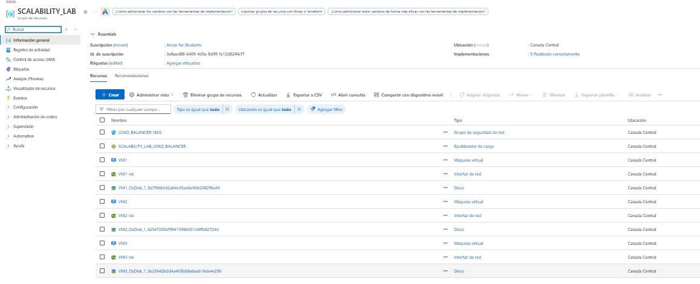

Contenedor de toda la solución. Agrupa 13 recursos en **Canada Central**: el balanceador y su IP pública, la red virtual, el grupo de seguridad de red, y por cada VM su máquina, su interfaz de red y su disco. Tenerlos en un solo grupo permite eliminarlos todos con una sola operación al terminar.

### Virtual Network

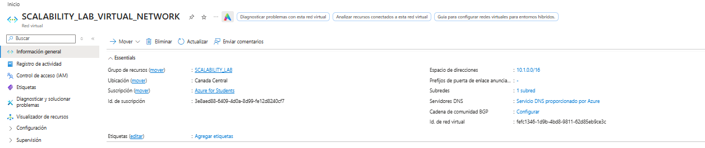

Red privada aislada donde viven los nodos. El **espacio de direcciones `10.1.0.0/16`** reserva 65.536 direcciones privadas. Es la frontera de red del sistema: lo que está dentro se comunica por IP privada sin salir a internet.

### Subnet

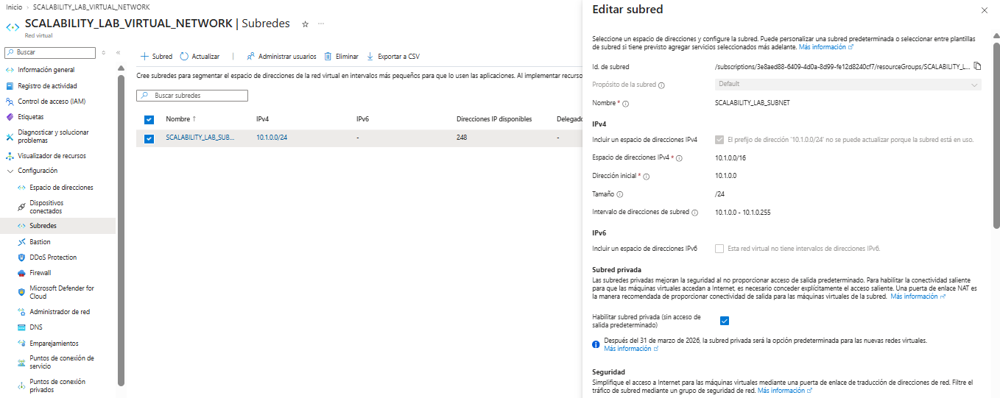

Segmento de la red virtual con rango **`10.1.0.0/24`**, es decir 256 direcciones de las cuales Azure reserva 5. De aquí salieron las IPs privadas de las VMs: `10.1.0.4` a `10.1.0.7`. En la captura se ve marcada la opción de **subred privada**, que elimina el acceso de salida predeterminado; no afectó porque la salida se resuelve por el balanceador.

### Load Balancer

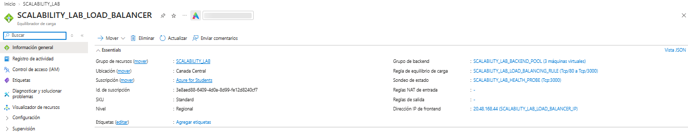

El punto de entrada único del sistema. Lo importante de esta pantalla: **SKU Standard** (requisito para usar zonas de disponibilidad), tipo **público**, y **dirección IP de frontend `20.48.168.44`**, que es la única IP que conoce el cliente. También se ven ya enlazados el backend pool, la regla y el sondeo.

### Backend Pool

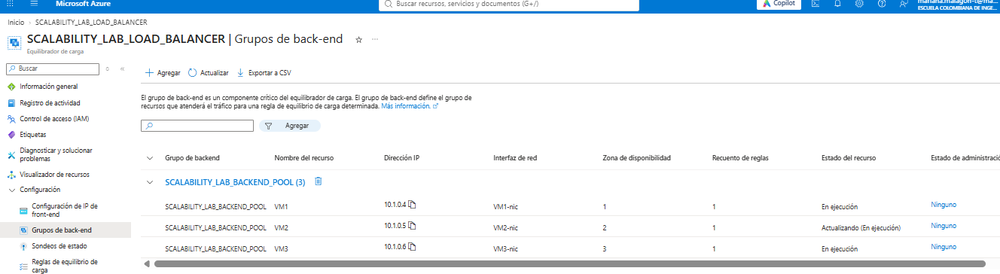

Conjunto de nodos que atienden el tráfico. Se ven las tres VMs con su **IP privada** y su **zona de disponibilidad: 1, 2 y 3**. Este es el recurso que hace posible la elasticidad: agregar o quitar nodos aquí no obliga a cambiar la IP pública ni la regla de balanceo.

### Health Probe

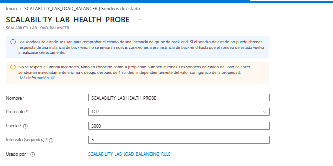

Comprueba la salud de cada nodo. Apunta al **puerto 3000**, que es donde escucha la aplicación, **no al 80** del frontend. Con intervalo de **5 segundos** y umbral de **2 fallos**, un nodo caído sale de rotación en unos 10 segundos.

### Load Balancing Rule

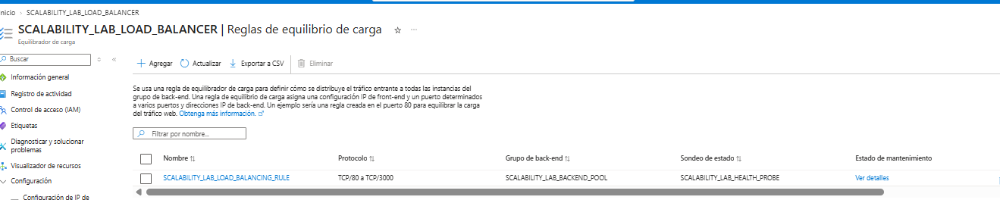

La pieza que une todo: traduce **TCP/80 a TCP/3000**, asocia el backend pool con el sondeo de estado, y es lo que permite consumir el servicio como `http://20.48.168.44/fibonacci/6` aunque la aplicación viva internamente en el 3000.

### Network Security Group

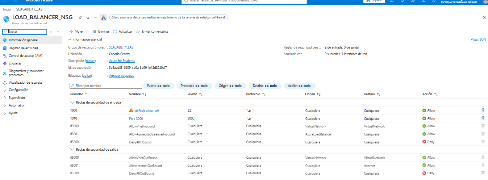

Firewall aplicado a las interfaces de red. Las reglas propias son **1000 (SSH, puerto 22)** y **1010 (Port_3000)**. Debajo se ven las reglas por defecto de Azure, entre ellas **`AllowAzureLoadBalancerInBound` (65001)**, que es la que permite el paso de los health probes, y **`DenyAllInBound` (65500)**, que bloquea todo lo demás. Sin la regla del 3000, el sondeo fallaría y el balanceador vaciaría el pool completo.

### VM1 (zona 1)

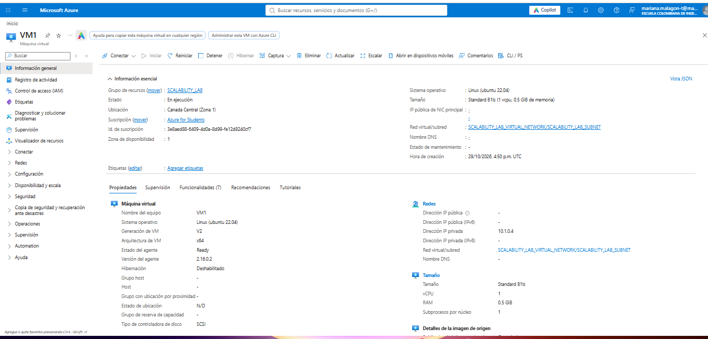

Primer nodo. Los datos relevantes: **Canada Central (Zona 1)**, tamaño **Standard B1ls** con 1 vCPU y 0.5 GiB de RAM, IP privada `10.1.0.4` y **sin IP pública**. El único vCPU es la razón por la que una sola petición satura la máquina.

### VM2 (zona 2)

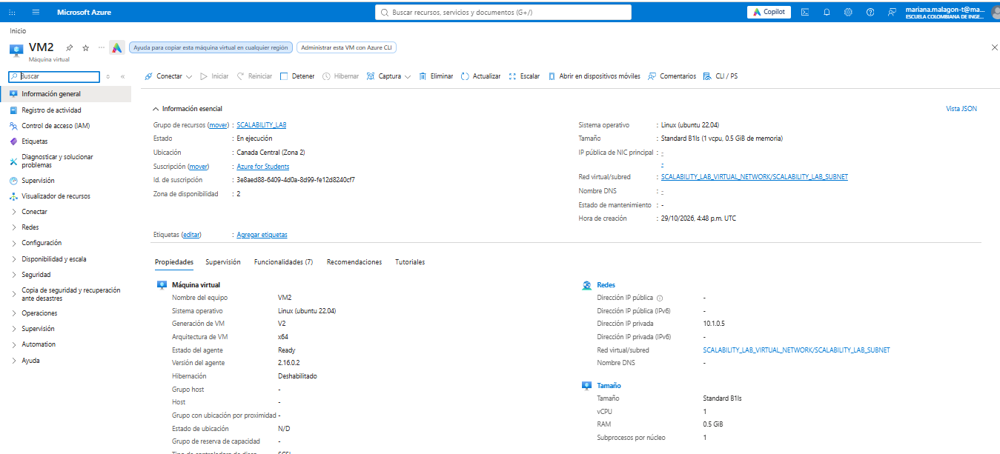

Segundo nodo, idéntico al anterior salvo por la **zona 2** y la IP `10.1.0.5`. Estar en otra zona significa otro centro de datos, con energía y red independientes.

### VM3 (zona 3)

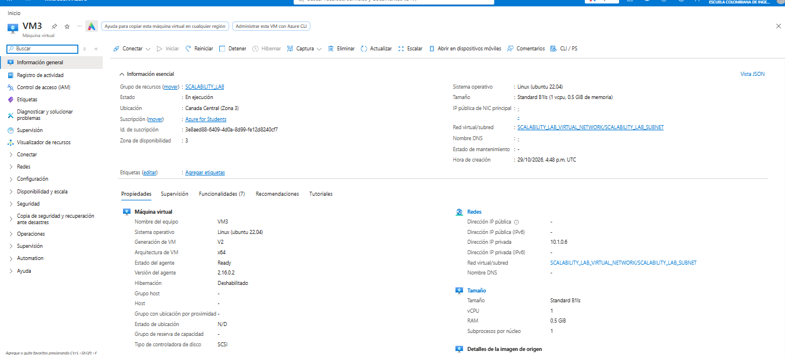

Tercer nodo, en **zona 3** con IP `10.1.0.6`. Con los tres repartidos en zonas distintas, la caída de un centro de datos deja el sistema operando al 66 % en lugar de tumbarlo.

### Aplicación instalada en las VMs

La instalación se automatizó con `az vm run-command invoke`, que ejecuta un script dentro de la VM sin necesidad de abrir una sesión SSH. El script instala Node.js 20, clona el repositorio, instala dependencias, registra el servicio `fibonacci.service` en systemd y verifica el resultado.

Salida de la verificación en cada nodo:

```
VM1 -> servicio: active | puerto 3000: escuchando | respuesta: The answer is 8
VM2 -> servicio: active | puerto 3000: escuchando | respuesta: The answer is 8
VM3 -> servicio: active | puerto 3000: escuchando | respuesta: The answer is 8
VM4 -> servicio: active | puerto 3000: escuchando | respuesta: The answer is 8
```

Los cuatro nodos quedaron con Node.js `v20.20.2`, el servicio activo y habilitado al arranque, y respondiendo correctamente en `localhost:3000`.

### Verificación funcional del balanceador

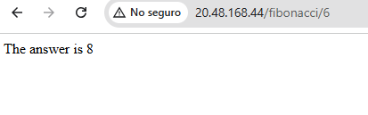

Prueba de extremo a extremo. El navegador consulta `http://20.48.168.44/fibonacci/6` y recibe `The answer is 8`. Esa única petición recorre toda la arquitectura: entra por el **puerto 80** a la IP pública del balanceador, la regla la traduce al **puerto 3000**, el hash de 5-tupla escoge uno de los nodos sanos del backend pool, y la aplicación responde desde una IP privada que no es alcanzable desde internet.

Que funcione confirma simultáneamente que el balanceador, la regla, el health probe, el NSG, la red virtual y la aplicación están bien configurados. Cualquier pieza mal puesta habría dado un error aquí.

Se verificó también el reparto: con **18 peticiones usando conexión nueva cada una**, el tráfico se distribuyó en **6, 6 y 6** entre VM1, VM2 y VM3.

### Prueba de newman con 2 procesos en paralelo

Comando ejecutado desde `FibonacciApp/postman/part2`, con `loadbalancer = 20.48.168.44`:

```
newman run ARSW_LOAD-BALANCING_AZURE.postman_collection.json -e "[ARSW_LOAD-BALANCING_AZURE].postman_environment.json" -n 10   (x2 en paralelo)
```

| Métrica | Ejecución 1 | Ejecución 2 |
|---|---|---|
| Iteraciones ejecutadas | 10 | 10 |
| Peticiones | 10 | 10 |
| **Fallidas** | **0** | **0** |
| Duración total | 2m 4.4s | 2m 7.9s |
| Tiempo de respuesta promedio | 12.3s | 12.7s |
| Mínimo | 12.2s | 12.2s |
| Máximo | 12.4s | 13.5s |
| Desviación estándar | 54 ms | 458 ms |
| Datos recibidos | 2.09 MB | 2.09 MB |

**Tasa de éxito: 20 de 20 peticiones, 100%.**

Resumen de newman en consola, correspondiente a una ejecución individual contra el balanceador:

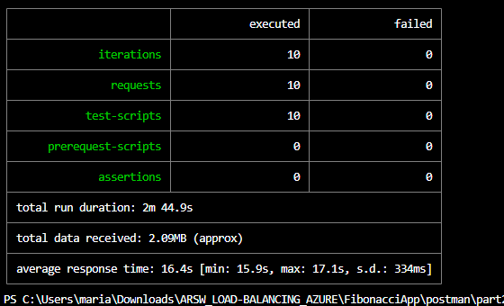

Se leen las tres cifras que importan: **10 iteraciones ejecutadas y 0 fallidas**, duración total de la corrida y tiempo de respuesta promedio con su mínimo, máximo y desviación estándar. La columna `failed` en cero en todas las filas es la evidencia directa de que el sistema respondió a la totalidad de las peticiones.

#### Distribución real de la carga

Contando en los logs de cada VM (`journalctl -u fibonacci | grep 'calculate 1000000'`) cuántas peticiones pesadas atendió cada nodo:

| VM | Zona | Peticiones `n=1000000` atendidas |
|---|---|---|
| VM1 | 1 | 10 |
| VM2 | 2 | 1 |
| VM3 | 3 | 10 |

Cada proceso de newman quedó fijado a **una sola VM** durante sus 10 iteraciones. Esto no es un defecto de la configuración: Azure Load Balancer distribuye mediante un **hash de 5-tupla** (IP origen, puerto origen, IP destino, puerto destino, protocolo) que se evalúa **por conexión TCP**, no por petición. Como newman mantiene la conexión HTTP viva (keep-alive) durante toda su ejecución, las 10 peticiones viajan por el mismo socket y aterrizan siempre en el mismo backend.

La consecuencia práctica es que **el número de nodos que se ejercitan está acotado por el número de conexiones TCP del cliente**, no por el tamaño del backend pool. Con 2 procesos solo se usaron 2 de las 3 VMs.

Esto se verificó por contraste: al lanzar 18 peticiones con `--no-keepalive`, es decir, abriendo una conexión nueva cada vez, el reparto fue **exactamente 6, 6 y 6** entre VM1, VM2 y VM3.

| Escenario | VM1 | VM2 | VM3 |
|---|---|---|---|
| 18 peticiones, conexión nueva cada una | 6 | 6 | 6 |
| 15 peticiones reutilizando conexión | 0 | 0 | 15 |

### Consumo de CPU de las VMs

Métrica *Percentage CPU*, agregación máximo, muestreo por minuto, durante la prueba de carga con 2 procesos en paralelo.

| VM | Zona | Pico de CPU | Peticiones atendidas |
|---|---|---|---|
| VM1 | 1 | **95.70 %** | 10 |
| VM2 | 2 | 1.1 % durante la prueba | 1 |
| VM3 | 3 | **95.06 %** | 10 |

Serie por minuto durante la ventana de la prueba:

```
VM1:  0.3  1.0  0.3  95.7  91.7
VM2:  1.1  0.6  1.0   0.4   0.5
VM3:  0.7 29.5 95.1  95.0   0.4
```

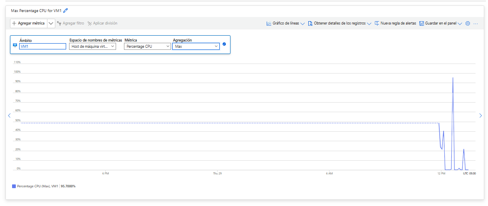

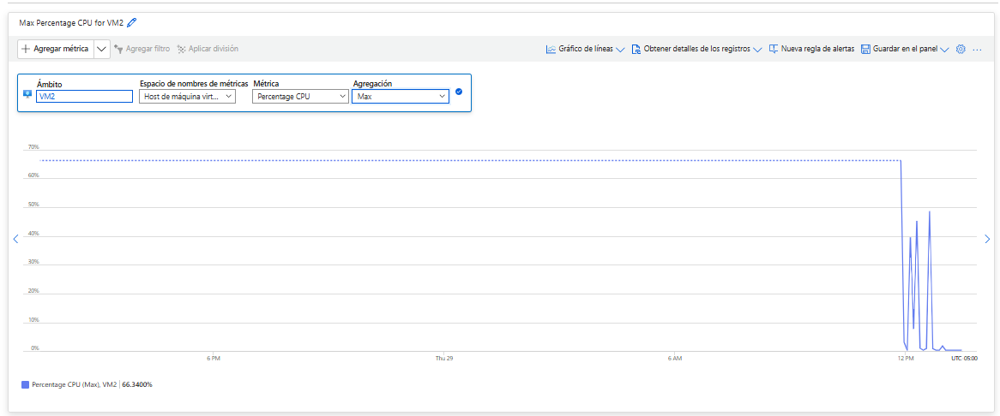

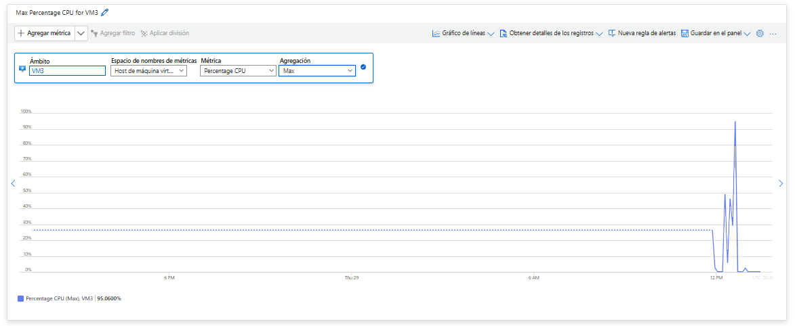

Las gráficas abarcan un rango mayor que la prueba, por lo que el valor de VM2 (66.34 %) corresponde a una medición manual aislada previa y no al periodo de la prueba de newman, durante el cual permaneció por debajo del 1.1 %.

#### Créditos de ráfaga

`Standard_B1ls` es una VM **burstable**: dispone de un rendimiento base bajo y acumula créditos de CPU mientras está ociosa, que gasta al superar esa base. Si los créditos se agotan, Azure estrangula la máquina a su rendimiento base.

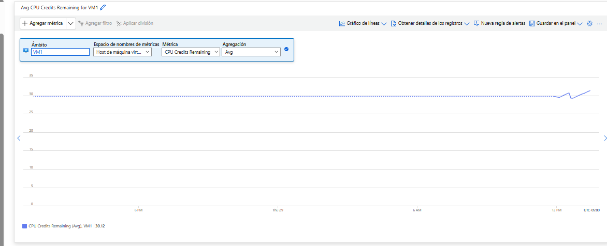

Durante la prueba los créditos de VM1 se mantuvieron alrededor de **30**, con un descenso leve y recuperación posterior. La conclusión es que **la prueba fue demasiado corta para agotarlos**, así que los picos del 95 % reflejan saturación real del núcleo y no degradación por falta de créditos.

Esto importa para interpretar bien los resultados: bajo una carga **sostenida** en el tiempo, y no en ráfagas de dos minutos, estos nodos añadirían un segundo modo de falla, porque al vaciarse los créditos el rendimiento caería al nivel base y los tiempos de respuesta se dispararían aún más.

#### Evaluación del escenario de calidad

El escenario exige dos cosas a la vez: que **todas las peticiones sean respondidas** y que el **consumo de CPU no supere el 70 %**.

| Criterio | Resultado | ¿Se cumple? |
|---|---|---|
| Todas las peticiones respondidas | 20 de 20, 0 fallos | **Sí** |
| CPU del sistema por debajo del 70 % | Picos de 95.7 % y 95.1 % | **No** |

El escenario **se cumple parcialmente**. La explicación está en la combinación de tres factores:

1. **La aplicación es CPU-bound y monohilo.** Node.js procesa una petición por vez en el event loop, y el cálculo de Fibonacci con `big-integer` consume el núcleo completo mientras dura.
2. **`Standard_B1ls` tiene un solo vCPU.** Basta una petición concurrente para saturarlo al 100 %. No hay margen para quedarse por debajo del 70 % mientras se atiende tráfico pesado.
3. **La carga no se repartió entre los 3 nodos**, sino entre 2, por el hash de 5-tupla explicado arriba. VM2 permaneció ociosa al 0.4 % mientras VM1 y VM3 estaban al 95 %.

Lo relevante es **qué sí resolvió el escalamiento horizontal**: la disponibilidad. Aunque cada nodo individual se saturó, **ninguna petición falló ni se perdió**, porque el trabajo se repartió entre máquinas independientes en lugar de acumularse en una sola. Con escalamiento vertical, todas las peticiones habrían competido por el mismo núcleo.

Para cumplir también el criterio de CPU harían falta, o más nodos de los que hay peticiones concurrentes, o un tamaño de VM con varios núcleos, o reescribir la función de Fibonacci con un algoritmo eficiente, que es la causa raíz real del problema.

### Informe comparativo con la Parte 1

Probamos las dos infraestructuras con la misma colección de newman (`n = 1000000`, 2 procesos de 10 iteraciones cada uno). Recuerden que en la Parte 1 usamos `D1_v2` y `D2_v2` en vez de `B1ls` y `B2ms` (ver [cambios de la Parte 1](#cambios-frente-a-la-guía-parte-1)).

| | Vertical: 1 VM D1_v2 | Vertical: 1 VM D2_v2 | Horizontal: 3 VMs B1ls con balanceador |
|---|---|---|---|
| vCPU en total | 1 | 2 | 3 |
| vCPU que la aplicación alcanza a usar | 1 | **1** | **3** (un proceso de Node en cada nodo) |
| Tiempo de respuesta promedio | 13.3 s y 11.9 s | 12.6 s y 13.2 s | 12.3 s y 12.7 s |
| Rango de tiempos | 9.5 s a 18.6 s | 9.3 s a 18.8 s | 12.2 s a 13.5 s |
| Peticiones respondidas | 11 de 20 (55 %) | 12 de 20 (60 %) | **20 de 20 (100 %)** |
| CPU máxima | 95.54 % | cerca de 50 % (un núcleo a tope y otro quieto) | 95.7 % y 95.1 % en cada nodo |
| Un solo punto de falla | Sí | Sí | No, 3 zonas |
| Para escalar hay que reiniciar | Sí | Sí | No, la VM4 se agregó en caliente |

Sobre los tiempos: el promedio de la horizontal (12.3 a 12.7 s) se parece al de la vertical, pero el rango cuenta otra historia. En la vertical los tiempos son de dos tipos, 9.5 s o 18.5 s, porque la mitad de las peticiones hace fila detrás del otro cliente, y las que no alcanzan a leerse terminan en `ECONNRESET`. En la horizontal todas tardan casi lo mismo (unos 12.3 s): nadie espera a nadie, porque cada cliente tiene su propio nodo. Que allá cada cálculo sea un poco más lento (12.3 s contra 9.5 s) es por el hardware: una `B1ls` es más modesta que una `D1_v2`.

Estos son los costos aproximados (Linux, pago por uso, sin contar disco ni tráfico; vale la pena confirmarlos en la [calculadora de Azure](https://azure.microsoft.com/es-es/pricing/calculator/)):

| Infraestructura | Qué incluye | Costo al mes, aprox. |
|---|---|---|
| Vertical D1_v2 | 1 D1_v2 y 1 IP pública (Chile Central) | unos 102 USD (97.82 USD es la VM, según el portal) |
| Vertical D2_v2 | 1 D2_v2 y 1 IP pública (Chile Central) | unos 200 USD |
| Vertical B2ms (el tamaño de la guía) | 1 B2ms y 1 IP pública | unos 65 USD |
| Horizontal | 3 B1ls, Load Balancer Standard (1 regla) y 1 IP pública (Canada Central) | unos 35 USD |
| Horizontal con VM4 | 4 B1ls, Load Balancer Standard y 1 IP pública | unos 39 USD |

En conclusión, la horizontal nos salió la más barata y fue la única que respondió el 100 % de las peticiones. La diferencia no está en cuántos núcleos hay, sino en cuántos puede usar la aplicación. FibonacciApp es un solo proceso con un solo hilo: en una VM grande solo usa un núcleo, tenga los que tenga. Repartida en varias VMs pequeñas, cada nodo corre su propio proceso y cada núcleo que pagamos sí trabaja. Además, la horizontal no tiene un solo punto de falla y la podemos escalar sin reiniciar nada. Eso sí, ninguna de las dos cumple lo de la CPU por debajo del 70 % en cada nodo; para eso toca arreglar el algoritmo.

### VM4 creada

Se agregó un cuarto nodo, `VM4`, en la zona de disponibilidad 1, con IP privada `10.1.0.7` y el mismo tamaño `Standard_B1ls`.

El punto a destacar es que **la incorporación se hizo en caliente**: se creó la interfaz de red ya asociada al `SCALABILITY_LAB_BACKEND_POOL`, y en cuanto el health probe detectó el puerto 3000 escuchando, el balanceador empezó a enviarle tráfico. **No hubo que detener el servicio, ni cambiar la IP `20.48.168.44`, ni modificar la regla de balanceo, ni tocar nada del lado del cliente.** Esa es, en la práctica, la propiedad que define al escalamiento horizontal.

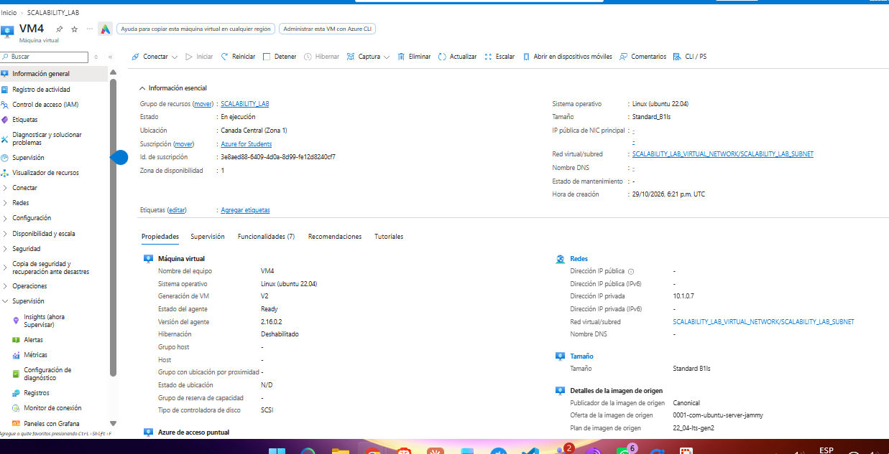

Backend pool con los cuatro nodos registrados y en ejecución:

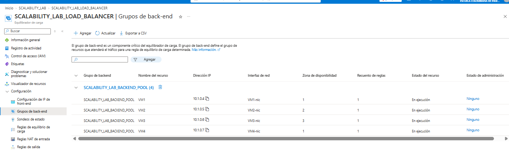

### Prueba de newman con 4 procesos en paralelo

Cuatro procesos simultáneos, 10 iteraciones cada uno, contra los 4 nodos.

| Métrica | Ejec. 1 | Ejec. 2 | Ejec. 3 | Ejec. 4 |
|---|---|---|---|---|
| Iteraciones | 10 | 10 | 10 | 10 |
| **Fallidas** | **0** | **0** | **0** | **0** |
| Duración total | 2m 45.8s | 2m 25.9s | 2m 4.5s | 2m 3.3s |
| Tiempo promedio | 16.4s | 14.5s | 12.3s | 12.2s |
| Mínimo | 15.9s | 14.4s | 12.2s | 12.1s |
| Máximo | 18.0s | 14.7s | 12.6s | 12.5s |
| Desviación estándar | 563 ms | 98 ms | 89 ms | 117 ms |

**Tasa de éxito: 40 de 40 peticiones, 100 %.**

#### Distribución de la carga

| VM | Zona | Peticiones atendidas |
|---|---|---|
| VM1 | 1 | 10 |
| VM2 | 2 | 10 |
| VM3 | 3 | 10 |
| VM4 | 1 | 10 |

Esta vez el reparto fue **perfecto**: cada proceso de newman estableció su propia conexión TCP y el hash de 5-tupla la asignó a un nodo distinto. Con 4 conexiones y 4 backends se ejercitó el 100 % del pool, frente al 66 % de la prueba anterior, donde 2 conexiones solo alcanzaron 2 de 3 nodos.

Esto confirma lo analizado en la pregunta 4: **el paralelismo efectivo lo determina el número de conexiones del cliente**, no el tamaño del backend pool.

#### Comparación entre las dos pruebas

| | Prueba con 2 procesos | Prueba con 4 procesos |
|---|---|---|
| Nodos disponibles | 3 | 4 |
| Peticiones totales | 20 | **40** |
| Peticiones fallidas | 0 | **0** |
| Tasa de éxito | 100 % | **100 %** |
| Tiempo de respuesta | 12.3s y 12.7s | 12.2s a 16.4s |
| Nodos efectivamente usados | 2 de 3 (66 %) | **4 de 4 (100 %)** |
| Pico de CPU | 95.7 % y 95.1 % | 95.9 %, 90.2 %, 96.0 %, 96.2 % |

**Al duplicar la carga, la tasa de éxito se mantuvo en el 100 % y el tiempo de respuesta se conservó en el mismo orden de magnitud.** El sistema absorbió el doble de trabajo sin degradarse de forma apreciable.

La variación entre 12.2s y 16.4s es consistente y bimodal: dos procesos rondaron los 12.2s y los otros dos los 14.5s y 16.4s. Se descartó que fuera agotamiento de créditos de ráfaga, porque la métrica `CPU Credits Remaining` se mantuvo entre **26.8 y 31.9** en las cuatro máquinas, lejos de cero.

La explicación más probable es la **heterogeneidad del hardware subyacente**: las cuatro VMs son del mismo tamaño nominal, pero Azure las aprovisiona sobre hosts físicos que pueden tener generaciones de procesador distintas. Para una carga puramente CPU-bound, esa diferencia se traduce directamente en tiempo de respuesta. Es una limitación conocida de los tamaños económicos, donde no se garantiza un modelo de CPU específico.

#### Por qué aumenta la tasa de éxito con escalamiento horizontal

Tres razones, en orden de importancia:

1. **La capacidad crece con los nodos.** Cada VM aporta un núcleo completo. Como la aplicación es monohilo y CPU-bound, cada nodo atiende una petición a la vez de forma eficiente. Con 4 nodos hay 4 peticiones en curso simultáneamente, cada una a velocidad plena.

2. **Sin escalamiento horizontal, la carga se serializa.** En una sola máquina, las 40 peticiones competirían por el mismo núcleo: el event loop de Node las encolaría y cada una tardaría tanto como la suma de las que tiene delante. A 12 segundos por petición, las últimas esperarían varios minutos y muchas morirían por timeout del cliente. El fallo no viene de que el servidor rechace, sino de que no alcanza a responder a tiempo.

3. **Los fallos quedan aislados.** Si un nodo se cae o se satura, el health probe lo saca de rotación en 10 segundos (2 fallos de 5 s cada uno) y sus peticiones se redistribuyen. En una sola máquina, su caída es la caída del sistema completo.

El contraste con el escalamiento vertical es claro: subir de `B1ls` a `B2ms` multiplica los recursos de **una** máquina, pero mantiene el punto único de falla y choca contra el techo del tamaño más grande disponible. Agregar nodos no tiene ese techo, y además permite repartirlos en zonas de disponibilidad distintas, lo que añade tolerancia a fallos de centro de datos.

### Consumo de CPU de las 4 VMs

Métrica *Percentage CPU*, agregación máximo, muestreo por minuto, durante la prueba con 4 procesos.

| VM | Zona | Pico de CPU |
|---|---|---|
| VM1 | 1 | **95.9 %** |
| VM2 | 2 | **90.2 %** |
| VM3 | 3 | **96.0 %** |
| VM4 | 1 | **96.2 %** |

Serie por minuto:

```
VM1:   0.4   0.4  95.9  95.5
VM2:  56.2  90.2  89.0
VM3:  32.7  96.0  93.6   0.4
VM4:  47.4  28.9  96.2  96.2  55.1  0.4
```

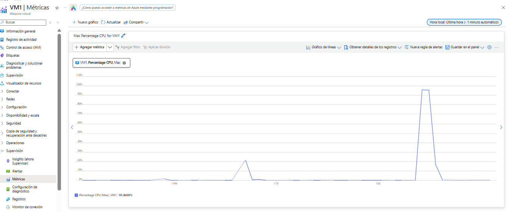

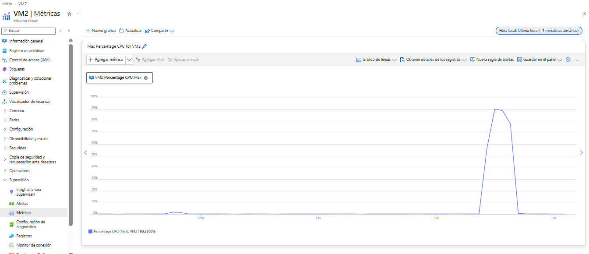

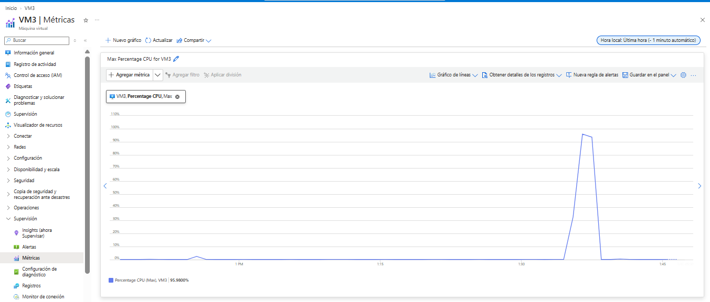

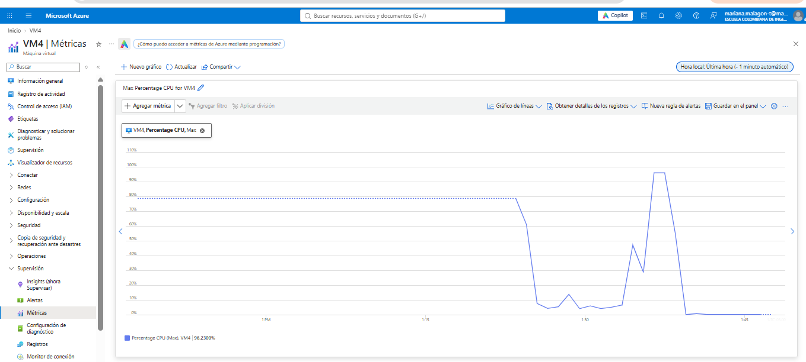

Las cuatro máquinas se saturaron de forma prácticamente simultánea, lo que confirma que la carga se repartió de manera uniforme. Ninguna quedó ociosa, a diferencia de VM2 en la prueba anterior. En las gráficas se aprecia además el pico menor y anterior de la prueba con 2 procesos, donde solo VM1 y VM3 registraron actividad.

El criterio de CPU por debajo del 70 % del escenario de calidad **sigue sin cumplirse**, y es coherente: cada nodo tiene un solo vCPU y una petición CPU-bound basta para saturarlo. Agregar nodos aumenta el **throughput** del sistema y su disponibilidad, pero no reduce el uso de CPU de cada nodo individual. Para bajar del 70 % harían falta más nodos que peticiones concurrentes, VMs con varios núcleos, o corregir el algoritmo de Fibonacci, que es la causa de fondo.

## Preguntas: Parte 2

**1. ¿Cuáles son los tipos de balanceadores de carga en Azure y en qué se diferencian? ¿Qué es SKU, qué tipos hay y en qué se diferencian? ¿Por qué el balanceador de carga necesita una IP pública?**

Azure ofrece cuatro servicios de balanceo, que se diferencian por la **capa del modelo OSI** en la que operan y por su **alcance geográfico**:

| Servicio | Capa | Alcance | Decide según | Caso de uso |
|---|---|---|---|---|
| **Azure Load Balancer** | 4 (TCP/UDP) | Regional | IP y puerto | Tráfico TCP/UDP genérico dentro de una región. Es el que usa este laboratorio. |
| **Application Gateway** | 7 (HTTP/S) | Regional | URL, host, cabeceras, cookies | Enrutamiento por ruta, terminación SSL, afinidad por cookie y firewall de aplicación (WAF). |
| **Traffic Manager** | DNS | Global | Resolución DNS | Reparte entre regiones devolviendo distintas IPs. No ve el tráfico, solo resuelve nombres. |
| **Front Door** | 7 | Global | URL y ubicación del cliente | Distribución global con caché de CDN, aceleración y WAF. |

La diferencia esencial es que el **Load Balancer no entiende HTTP**: toma la decisión mirando únicamente la cabecera TCP. Esto lo hace muy rápido y agnóstico al protocolo, pero le impide enrutar por URL o leer cookies. Para este laboratorio es suficiente y es lo correcto, porque solo necesitamos repartir conexiones hacia un mismo servicio.

**SKU** (*Stock Keeping Unit*) es el nivel de servicio del recurso: define capacidades, límites y precio.

| SKU | Estado | Características |
|---|---|---|
| **Basic** | **Retirado el 30/09/2025** | Gratuito, sin soporte de zonas de disponibilidad, hasta 300 instancias, sin SLA. |
| **Standard** | Vigente | Soporta zonas de disponibilidad, hasta 1000 instancias, SLA del 99.99 %, reglas de salida configurables y es *seguro por defecto*: todo el tráfico se bloquea salvo que un NSG lo permita explícitamente. |
| **Gateway** | Vigente | Para encadenar appliances virtuales de red (NVA) de terceros. |

En este laboratorio el SKU **Standard era obligatorio** por dos razones: Basic ya no existe, y es el único que permite distribuir las VMs en zonas de disponibilidad, que es un requisito del ejercicio.

**Por qué necesita una IP pública:** porque se configuró como balanceador de tipo *Public*, es decir, el punto de entrada del sistema desde internet. La configuración de frontend necesita una dirección enrutable públicamente para que los clientes puedan alcanzarla; en nuestro caso `20.48.168.44`. Las VMs detrás solo tienen IPs privadas (`10.1.0.4` a `10.1.0.7`), que no son alcanzables desde fuera de la red virtual.

En esta implementación esa IP cumple **una segunda función**: como las VMs no tienen IP pública propia, el balanceador les provee la salida a internet mediante SNAT a través de su frontend. Fue lo que permitió que las VMs descargaran Node.js y clonaran el repositorio.

**2. ¿Cuál es el propósito del *Backend Pool*?**

El backend pool es el **conjunto de instancias que atenderán el tráfico** que entre por el balanceador. En esta implementación, `SCALABILITY_LAB_BACKEND_POOL` agrupa las interfaces de red de VM1, VM2, VM3 y VM4.

Su valor arquitectónico es el **desacoplamiento**: el cliente conoce una sola dirección estable (la IP del frontend) y nunca sabe cuántos nodos hay detrás ni cuáles son. Agregar o quitar máquinas es una operación sobre el pool que no obliga a tocar la regla de balanceo, ni la IP pública, ni la configuración del cliente.

Eso es exactamente lo que hace posible la escalabilidad horizontal, y se comprobó en la práctica: **VM4 se agregó al sistema en caliente**, sin interrumpir el servicio, sin cambiar la IP `20.48.168.44` y sin reconfigurar nada del lado del cliente.

**3. ¿Cuál es el propósito del *Health Probe*?**

El health probe **verifica periódicamente que cada instancia del backend pool esté viva** y saca de rotación a las que no respondan, para que el balanceador no les envíe tráfico.

Configuración usada:

| Parámetro | Valor | Significado |
|---|---|---|
| Protocolo | TCP | Verifica que el puerto acepte conexiones |
| Puerto | **3000** | El puerto donde escucha la aplicación, no el 80 del frontend |
| Intervalo | 5 segundos | Frecuencia de la comprobación |
| Umbral | 2 fallos | Comprobaciones fallidas consecutivas antes de marcar la instancia como no sana |

El detalle importante es que **el probe apunta al 3000, no al 80**. El puerto 80 es donde escucha el balanceador de cara a internet; dentro de la red virtual la aplicación escucha en el 3000. Si el probe apuntara al 80, fallaría en todas las instancias y el balanceador vaciaría el pool completo.

Se comprobó su funcionamiento de forma involuntaria durante el despliegue: mientras VM2 y VM3 todavía estaban instalando la aplicación, **el balanceador siguió respondiendo correctamente** porque el probe las tenía marcadas como no sanas y enviaba todo el tráfico a VM1, la única que ya tenía el servicio arriba. Sin health probe, un tercio de las peticiones habría fallado durante ese periodo.

**4. ¿Cuál es el propósito de la *Load Balancing Rule*? ¿Qué tipos de sesión persistente existen, por qué esto es importante y cómo puede afectar la escalabilidad del sistema?**

La regla de balanceo es la que **une todas las piezas**: asocia una configuración de frontend y un puerto de entrada con un backend pool y un puerto de destino, usando un health probe como criterio de salud.

La regla `SCALABILITY_LAB_LOAD_BALANCING_RULE` define: TCP, puerto de frontend **80**, puerto de backend **3000**, pool `SCALABILITY_LAB_BACKEND_POOL`, probe `SCALABILITY_LAB_HEALTH_PROBE`. Es lo que permite consumir el servicio como `http://20.48.168.44/fibonacci/6` aunque internamente la aplicación viva en el 3000.

**Tipos de sesión persistente en Azure Load Balancer:**

| Tipo | Hash | Comportamiento |
|---|---|---|
| **None** (predeterminado) | 5-tupla: IP origen, puerto origen, IP destino, puerto destino, protocolo | Cada conexión nueva puede ir a un nodo distinto. Es la mejor distribución. |
| **Client IP** | 2-tupla: IP origen, IP destino | Todas las conexiones de una misma IP cliente van siempre al mismo nodo. |
| **Client IP and protocol** | 3-tupla: IP origen, IP destino, protocolo | Igual que la anterior, diferenciando por protocolo. |

**Por qué importa:** si la aplicación guarda estado en memoria del servidor (una sesión de usuario, un carrito de compras), las peticiones de ese usuario deben llegar siempre al mismo nodo o el estado se pierde. La persistencia resuelve eso.

**Cómo afecta la escalabilidad:** negativamente, y de forma severa. Con *Client IP*, todo el tráfico que venga detrás de un mismo NAT corporativo o universitario se concentra en un solo nodo, dejando el resto ociosos. Peor aún: al escalar, los nodos nuevos solo reciben clientes nuevos, nunca descargan a los que ya están saturados. Y si un nodo cae, sus usuarios pierden la sesión.

Por eso se configuró **None**: la aplicación de Fibonacci es *stateless*, no guarda nada entre peticiones, así que no necesita afinidad y conviene repartir lo máximo posible.

**Hallazgo experimental relevante:** incluso con persistencia en *None*, se observó afinidad de facto. El hash de 5-tupla se evalúa **por conexión TCP**, no por petición HTTP. Como `newman` mantiene la conexión viva (keep-alive) durante sus 10 iteraciones, las 10 peticiones viajaron por el mismo socket y cayeron todas en el mismo nodo. El resultado fue que **con 2 procesos solo se usaron 2 de las 3 VMs**, mientras la tercera quedaba ociosa al 0.4 % de CPU.

La conclusión práctica es que, en un balanceador de capa 4, **el paralelismo real está limitado por el número de conexiones TCP que abra el cliente**, no por el tamaño del backend pool. Se verificó por contraste: lanzando 18 peticiones con `--no-keepalive`, el reparto fue exactamente 6, 6 y 6. Un Application Gateway, al operar en capa 7, sí distribuiría petición por petición sobre una misma conexión.

**5. ¿Qué es una *Virtual Network*? ¿Qué es una *Subnet*? ¿Para qué sirven los *address space* y *address range*?**

Una **Virtual Network (VNet)** es una red privada y aislada lógicamente dentro de Azure. Funciona como el equivalente en la nube de una red local: los recursos que viven dentro se comunican entre sí por direcciones privadas, sin pasar por internet, y están aislados del tráfico de otros clientes de Azure. Aquí es `SCALABILITY_LAB_VIRTUAL_NETWORK`.

Una **Subnet** es una subdivisión de esa red. Sirve para segmentar: agrupar recursos con necesidades similares de conectividad y de seguridad, y aplicarles políticas distintas (NSG, tablas de rutas). En una arquitectura real se separarían la capa web, la de aplicación y la de base de datos en subredes distintas. En este laboratorio basta una, `SCALABILITY_LAB_SUBNET`, porque los 4 nodos son idénticos y cumplen la misma función.

El **address space** es el rango total de direcciones IP privadas que la VNet reserva, expresado en notación CIDR. Aquí es `10.1.0.0/16`, que abarca de `10.1.0.0` a `10.1.255.255`, es decir 65.536 direcciones.

El **address range** es la porción de ese espacio que se asigna a una subred concreta. Aquí es `10.1.0.0/24`, de `10.1.0.0` a `10.1.0.255`, 256 direcciones, de las cuales Azure reserva 5 (la primera, la última y tres para servicios internos), dejando 251 utilizables.

Su propósito es doble: **evitar colisiones de direcciones**, tanto entre subredes como con redes locales en escenarios híbridos conectados por VPN, y **dimensionar** la capacidad de crecimiento. En este despliegue las VMs recibieron `10.1.0.4`, `10.1.0.5`, `10.1.0.6` y `10.1.0.7` dentro de ese rango.

**6. ¿Qué son las *Availability Zone* y por qué seleccionamos 3 diferentes zonas? ¿Qué significa que una IP sea *zone-redundant*?**

Una **Availability Zone** es una ubicación físicamente separada dentro de una misma región de Azure, con **alimentación eléctrica, refrigeración y red independientes**. Cada región que las soporta tiene al menos tres, separadas por una distancia suficiente para que un desastre localizado no afecte a más de una, pero conectadas por fibra de baja latencia para que se comporten como una sola red.

**Por qué 3 zonas distintas:** para eliminar el punto único de falla a nivel de centro de datos. Si las tres VMs estuvieran en el mismo edificio, un corte de energía las tumbaría todas a la vez y el sistema caería completo, por más balanceador que hubiera. Repartidas en 3 zonas, la caída de una deja el sistema operando al 66 % de capacidad: el health probe detecta las instancias caídas en 10 segundos (2 fallos con 5 s de intervalo) y las saca de rotación, y el tráfico sigue fluyendo a las sobrevivientes.

Es la diferencia entre escalar para **rendimiento** y escalar para **disponibilidad**. El backend pool da lo primero; distribuirlo en zonas da lo segundo.

En este despliegue: VM1 en zona 1, VM2 en zona 2, VM3 en zona 3 y VM4 en zona 1.

**Que una IP sea *zone-redundant*** significa que Azure la sirve **simultáneamente desde las tres zonas** en lugar de anclarla a una. Si una zona cae, la dirección sigue siendo alcanzable desde las otras dos, sin cambio de IP ni intervención manual.

Esto es imprescindible aquí: de nada serviría tener las VMs repartidas en 3 zonas si la IP del balanceador, que es el único punto de entrada, viviera en una sola. La caída de esa zona dejaría el sistema inalcanzable aunque todos los nodos siguieran sanos. Por eso `SCALABILITY_LAB_LOAD_BALANCER_IP` se creó como **Standard, Static y Zone-redundant**. Nótese que solo el SKU Standard admite esta propiedad.

**7. ¿Cuál es el propósito del *Network Security Group*?**

El NSG es un **firewall distribuido con estado** que filtra el tráfico de red mediante reglas de 5-tupla (origen, puerto origen, destino, puerto destino, protocolo). Se puede asociar a una subred o a una interfaz de red; aquí `LOAD_BALANCER_NSG` está asociado a las 4 NICs.

Reglas de entrada configuradas:

| Prioridad | Nombre | Puerto | Propósito |
|---|---|---|---|
| 1000 | `default-allow-ssh` | 22 | Administración remota de las VMs |
| 1010 | `Port_3000` | 3000 | Tráfico de la aplicación, que es el que reenvía el balanceador |

Las reglas se evalúan **en orden de prioridad ascendente** y la primera que coincide gana. Además de las personalizadas, Azure añade reglas por defecto en prioridades altas, entre ellas `AllowAzureLoadBalancerInBound` (65001), que permite el tráfico del balanceador, **incluidos los health probes**, y `DenyAllInBound` (65500), que bloquea todo lo demás.

Por qué es necesario aquí: el SKU **Standard es cerrado por defecto**. Sin una regla explícita que abra el 3000, el health probe no podría alcanzar la aplicación, marcaría las cuatro instancias como no sanas y el balanceador devolvería error aunque la aplicación estuviera funcionando perfectamente. El NSG es, por tanto, un requisito funcional del sistema, no solo una medida de seguridad.

**8. Informe de newman 1 (Punto 2)**

Los resultados completos están en la sección [Prueba de newman con 2 procesos en paralelo](#prueba-de-newman-con-2-procesos-en-paralelo) de las evidencias. Resumen:

| Métrica | Valor |
|---|---|
| Peticiones totales | 20 (2 procesos de 10 iteraciones) |
| Peticiones exitosas | **20 (100 %)** |
| Peticiones fallidas | **0** |
| Tiempo de respuesta promedio | 12.3 s y 12.7 s |
| Rango | 12.2 s a 13.5 s |
| Desviación estándar | 54 ms y 458 ms |
| Pico de CPU en los nodos con carga | 95.7 % y 95.1 % |

La interpretación está desarrollada en [Evaluación del escenario de calidad](#evaluación-del-escenario-de-calidad): el requisito de **responder todas las peticiones se cumple**, el de **mantener la CPU por debajo del 70 % no**, y la causa de fondo es el algoritmo de Fibonacci, no la infraestructura.

---

# Diagrama de despliegue

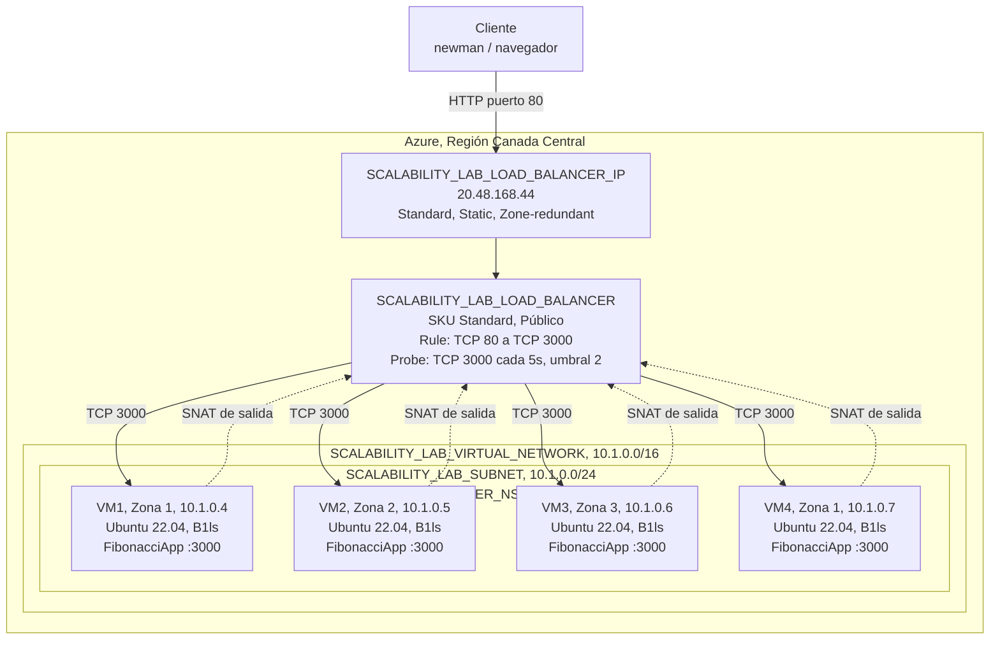

**Nodos y artefactos desplegados**

| Nodo | Artefacto | Puerto | Zona |
|---|---|---|---|
| VM1 | FibonacciApp sobre Node.js 20, servicio `fibonacci.service` | 3000 | 1 |
| VM2 | FibonacciApp sobre Node.js 20, servicio `fibonacci.service` | 3000 | 2 |
| VM3 | FibonacciApp sobre Node.js 20, servicio `fibonacci.service` | 3000 | 3 |
| VM4 | FibonacciApp sobre Node.js 20, servicio `fibonacci.service` | 3000 | 1 |

**Flujos de comunicación**

- **Entrada** (línea continua): el cliente llega a la IP pública por el puerto 80. La regla de balanceo reenvía al puerto 3000 de un nodo del backend pool, elegido por hash de 5-tupla sobre la conexión TCP.
- **Salida** (línea punteada): como los nodos no tienen IP pública propia, su tráfico saliente se traduce (SNAT) a través del frontend del balanceador. Es lo que les permitió descargar Node.js y clonar el repositorio durante el aprovisionamiento.
- **Supervisión**: el health probe abre una conexión TCP al puerto 3000 de cada nodo cada 5 segundos. Tras 2 fallos consecutivos, el nodo sale de rotación y deja de recibir tráfico.

---

# Conclusiones

**1. El escalamiento horizontal resolvió la disponibilidad, no la saturación.**

En las dos pruebas de carga se respondió el **100 % de las peticiones**, 20 de 20 y 40 de 40, sin un solo fallo. Pero el consumo de CPU de cada nodo con tráfico alcanzó picos del 95 %, muy por encima del 70 % que exige el escenario de calidad. El escenario, por tanto, **se cumple parcialmente**.

La distinción es importante: agregar nodos multiplica el **throughput** del sistema y aísla los fallos, pero no reduce el uso de CPU de cada máquina individual. Un nodo saturado sigue saturado aunque haya otros tres al lado.

**2. La causa raíz no es la infraestructura, es el algoritmo.**

Calcular el término 1.000.000 de Fibonacci iterando un millón de sumas de enteros de precisión arbitraria cuesta 12 segundos de CPU al 100 %. Ninguna topología de despliegue arregla eso: solo lo reparte. Escalar fue una forma de **comprar tiempo**, no de resolver el problema. La solución real sería un algoritmo eficiente, o cachear resultados, antes que añadir máquinas.

**3. El paralelismo real lo impone el cliente, no el backend pool.**

Fue el hallazgo más inesperado del laboratorio. Con la persistencia de sesión en `None`, se esperaba reparto uniforme; sin embargo, con 2 procesos de newman solo se usaron **2 de 3 nodos**, dejando uno ocioso al 0.4 % mientras los otros dos agonizaban al 95 %.

La explicación es que Azure Load Balancer opera en **capa 4**: su hash de 5-tupla se evalúa por conexión TCP, no por petición HTTP. Como newman mantiene keep-alive, sus 10 peticiones viajan por el mismo socket y aterrizan en el mismo nodo. Al repetir con `--no-keepalive` el reparto fue exacto: **6, 6 y 6**. Y con 4 procesos sobre 4 nodos, **10, 10, 10 y 10**.

La lección de diseño: para una aplicación HTTP con clientes que reutilizan conexiones, un **Application Gateway** (capa 7), que distribuye petición por petición, repartiría mejor que un Load Balancer.

**4. La elasticidad es real y verificable.**

VM4 se incorporó al sistema **sin interrumpir el servicio**: sin cambiar la IP pública, sin tocar la regla de balanceo y sin reconfigurar el cliente. El health probe la detectó y empezó a enviarle tráfico automáticamente. Eso es precisamente lo que el escalamiento vertical no puede ofrecer, porque redimensionar una VM exige reiniciarla y provoca downtime.

**5. Las restricciones reales del entorno moldean la arquitectura.**

El laboratorio no se pudo ejecutar tal como estaba escrito. La suscripción impuso una política que limita a 5 regiones, de las cuales solo 2 ofrecían `B1ls` con zonas de disponibilidad; un tope de 3 IPs públicas por región que obligó a dejar las VMs sin IP propia; y el retiro del SKU Basic. Cada restricción exigió una decisión de diseño: usar Canada Central, resolver la salida a internet por el SNAT del balanceador, y usar Standard.

Ninguna alteró la arquitectura evaluada, pero todas confirman que **una arquitectura no se diseña en el vacío**: las capacidades y los límites del proveedor son parte del problema.

**6. Disponibilidad por zonas.**

Distribuir los nodos en 3 zonas de disponibilidad y usar una IP zone-redundant protege contra la caída de un centro de datos completo. Con el health probe configurado a 5 segundos de intervalo y umbral de 2, el sistema detecta y aísla un nodo caído en unos **10 segundos**, y sigue operando con capacidad reducida en lugar de caer por completo.

---

# Limpieza de recursos

- [ ] En el portal de Azure: *Resource groups*, luego `SCALABILITY_LAB` y luego **Delete resource group**

Esto elimina en una sola operación el Load Balancer, la IP pública, la Virtual Network, el NSG, las VMs, sus discos y sus NIC.
